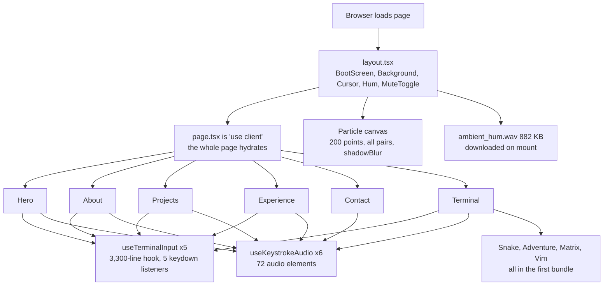
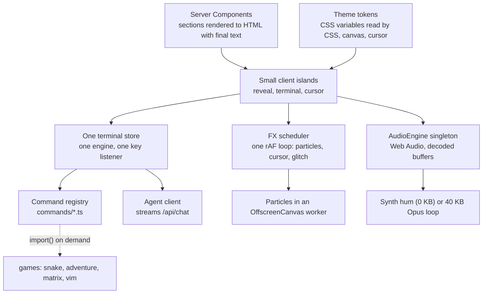
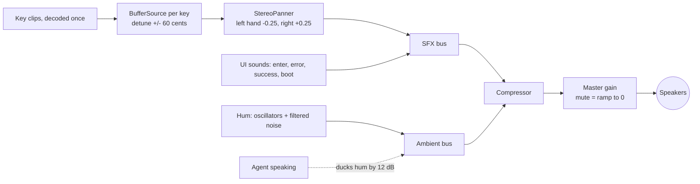

Review of kudzai's terminal portfolio · 24 Oct 2026

# Phosphor Portfolio Review

I read the portfolio's code from end to end. The idea is strong and the craft is real. Below is what slows it down, what feels rough, and a concrete plan to make it feel smooth and expensive. Every demo on this page runs live, so you can see and hear each suggestion before you build it.

**80** files **\~18,000** lines read Next.js **16** · React **19** commit **a864e02**

[00Verdict and prioritiesWhat's great, what to fix first](#verdict) [01Architecture and speedRendering, bundle, canvas, bugs](#part1) [02UI/UX: typing, motion, audio, colourThe most important part, with live demos](#part2) [03Code cleanupWhat to delete or merge, same behaviour](#cleanup) [04ResearchTools, platform features, ideas to borrow](#part4) [05Other suggestions and roadmapRecruiters, content, testing, agent](#part3)

00 · Verdict

## A great concept held back by its own ceremony

The site is a pseudo-OS: it boots, types out every section, plays keystroke audio, ships games, and has an AI agent that can act on the page and listen to your voice. That is far more ambitious than most portfolios, and the engineering underneath it is careful. The animation controller cancels cleanly, the audio has a section arbiter, reduced motion is respected everywhere, and the README is excellent.

The problems come from the same ambition. The visitor waits about **21 seconds** on a first visit before the hero is fully readable. The whole page renders on the client, so the real content arrives late. Five copies of a 3,300-line hook run at once. The audio system can't control volume on iPhones at all. And a few real bugs break the experience on common hardware.

#### Keep and build on

- Typing engine tuned in one config file
- Cancellation-safe animation controller
- Audio ownership per section
- Reduced-motion paths everywhere
- Agent split server/client, grounded on content

#### Fix first

- No cursor at all on touchscreen laptops
- Two ripples on every click
- Ambient hum at full volume on iOS
- 882 KB WAV loaded before the boot screen ends
- \~21 s until the first section is readable

### Priority list

Effort: XS is under an hour, S is half a day, M is one to three days, L is a week or more.

| # | Change | Type | Where | Effort |
| --- | --- | --- | --- | --- |
| 1 | Show the custom cursor on touchscreen laptops (currently no cursor at all) | bug | `CustomCursor.tsx:66` | S |
| 2 | Spawn one click ripple, not two | bug | `Background.tsx:95` | XS |
| 3 | Re-encode the hum to a \~40 KB Opus loop, or synthesise it; load after boot | speed | `AmbientHum.tsx:22` | XS |
| 4 | Shorten the boot, let any key continue, and skip it for returning visitors | ux | `BootScreen.tsx` | S |
| 5 | Load a real terminal font with `next/font` | ux | `globals.css:48` | XS |
| 6 | Use `100dvh` for sections on mobile; make the cursor smoothing frame-rate independent | ux | `globals.css:374` | XS |
| 7 | Move keystrokes and hum to one Web Audio engine (fixes iOS volume, adds real pitch and stereo) | ux | `useKeystrokeAudio.ts` | M |
| 8 | Typing v2: word bursts, rare typo corrections, line-streamed output, skip on any key | ux | `useTypingAnimation.ts` | M |
| 9 | Theme tokens read by CSS, canvas and cursor, plus a `theme` command | ux | `globals.css`, `particles.ts` | M |
| 10 | Particles: glow sprite instead of `shadowBlur`, spatial grid, DPR-aware canvas | speed | `particles.ts:472` | M |
| 11 | Stream AI replies so the first words appear in under half a second | speed | `app/api/chat/route.ts` | M |
| 12 | Server-render the section content; animate it with small client islands | arch | `app/page.tsx:1` | L |
| 13 | Split `useTerminalInput` into modules with one shared store; lazy-load games | arch | `useTerminalInput.ts` | L |

01 · Architecture, speed, smoothness

## Make the content arrive first and the effects arrive second

The guiding rule for this part: the HTML that reaches the browser should already contain the finished text of every section. Animation then becomes a way of *revealing* content that already exists, instead of the only way content ever appears. That one shift fixes load speed, SEO, and screen-reader support at the same time, and it lets you delete the hidden duplicate copy in `SEOContent.tsx`.

### How it works today

`app/page.tsx` starts with `"use client"`, so every section is a client component. Each section begins with empty strings and builds its text one `setState` per character. Five sections each create their own `useTerminalInput` instance, and six sections each create their own pool of audio elements.



### Where it should go

Sections become Server Components that print their final text into the HTML. A small client island adds the reveal animation on top. All terminals share one engine and one keyboard listener. Games load only when someone types `snake`. Every moving effect shares one animation-frame loop, and audio goes through one engine.



### The time it takes to read the hero

I added up the delays in `BootScreen.tsx` and `typingConfig.ts`. The boot log takes 5.8 s before the Start button appears, the exit sequence takes 4.3 s, and the hero's three typed commands take about 10 s with their pauses. With a one-second reaction to click Start, a first-time visitor waits around 21 s. Recruiters often decide in under ten.

#### Seconds from landing to a fully readable hero

estimated from config

Boot log Waiting for a click Exit animation Hero typing

Proposed: the boot log auto-continues after 1.6 s (any key skips it), the exit is a 0.6 s CRT power-on, and the hero types only the commands while output prints line by line. Returning visitors skip the boot (store it in `localStorage`, not `sessionStorage`, which forgets on every new tab).

### Findings

#### bug Touchscreen laptops get no cursor at all

The CSS hides the system cursor whenever the main pointer is a mouse (`hover: hover` and `pointer: fine`). The JS then removes the custom cursor whenever `navigator.maxTouchPoints > 0`. A Surface, a Dell XPS with touch, or any Windows laptop with a touchscreen matches both. The result is a page with no cursor. The particle field also treats these laptops as phones and drops to 70 particles at 30 fps.

src/components/layout/CustomCursor.tsx:66 · app/globals.css:184 · src/components/layout/Background.tsx:30

```
// Decide per pointer event, not per device. A laptop can have both.
const onPointerMove = (e: PointerEvent) => {
  const isMouse = e.pointerType === 'mouse'
  document.documentElement.classList.toggle('has-custom-cursor', isMouse)
}
/* CSS: only hide the system cursor once JS has shown ours */
html.has-custom-cursor * { cursor: none !important; }
```

#### bug Every click spawns two ripples

`Background.tsx` adds a `.mouse-ripple` on `click` and `CustomCursor.tsx` adds another on `mousedown`. They start about 100 ms apart, so the ring visibly doubles. Delete the one in Background and keep the cursor's, because it is placed at the smoothed cursor position.

src/components/layout/Background.tsx:95 · src/components/layout/CustomCursor.tsx:181

#### speed The ambient hum is an 882 KB WAV, fetched before anyone hears it

`new Audio('/sounds/ambient_hum.wav')` with `preload = 'auto'` runs on mount, during the boot screen. That one file is about fifteen times the size of all the keystroke clips together. Encode it as a seamless Opus or AAC loop (around 40 KB) and create it only after boot, or synthesise it with oscillators for zero bytes (the Sound Lab below does exactly that).

src/components/shared/AmbientHum.tsx:22 · public/sounds/ambient_hum.wav

#### arch Five terminals, five engines

`useTerminalInput` holds the shell, a fake filesystem, the games, the tour and the agent client. Hero, About, Projects, Experience and Terminal each call it, so the page runs five copies with about twenty pieces of state each and five `document` keydown listeners. Split it into modules (`commands/`, `fs.ts`, `agent.ts`, `games/`), keep the state in one small store such as Zustand or `useSyncExternalStore`, and give each section a view onto it. Load games with `import()` the first time they run.

src/hooks/useTerminalInput.ts:2091 · :3216

```
// commands/registry.ts
export const commands: Record<string, Command> = {
  whoami: { run: whoami },
  snake:  { run: async (ctx) => (await import('../games/snake')).start(ctx) },
  matrix: { run: async (ctx) => (await import('../games/matrix')).start(ctx) },
}
```

#### speed Typing re-renders whole sections, and AI replies queue one timer per character

Each typed character calls `setText`, which re-renders the section component and everything in it. For AI replies, `useTerminalInput.ts:2224` schedules one `setTimeout` per character up front, so a 900-character answer creates 900 timers and copies the string 900 times. Use one animation-frame loop that writes straight into a text node, and let React own only the finished line.

src/hooks/useTypingAnimation.ts:206 · src/hooks/useTerminalInput.ts:2224

```
function typeInto(node: Text, text: string, msPerChar: number, signal: AbortSignal) {
  return new Promise<void>((done) => {
    const start = performance.now()
    const tick = (now: number) => {
      if (signal.aborted) { node.data = text; return done() }   // skip = finish instantly
      const n = Math.min(text.length, Math.floor((now - start) / msPerChar))
      if (n !== node.data.length) node.data = text.slice(0, n)    // no React render
      n < text.length ? requestAnimationFrame(tick) : done()
    }
    requestAnimationFrame(tick)
  })
}
```

#### speed The particle field pays for glow on every frame

200 particles are compared in all pairs (19,900 checks with a square root each), each line sets its own stroke style, and glow uses `shadowBlur`, which is one of the slowest operations in Canvas 2D. The canvas also ignores `devicePixelRatio`, so it looks soft on Retina and 4K screens. Draw a glow sprite once and stamp it with `drawImage`, bucket particles into a grid, batch lines into three paths by opacity, and size the canvas for the screen's pixel density (capped at 2). The bench below runs both versions side by side so you can see the cost on your own machine.

src/lib/particles.ts:472 · :512 · :664

#### Particle bench

measuring…

200 particles, same motion in both modes. The number is the average CPU time spent drawing one frame over the last 60 frames. At 60 fps a frame has 16.7 ms in total, shared with typing, React and the cursor.

#### smoothness The cursor moves faster on 120 Hz and 144 Hz screens

The cursor eases toward the mouse by a fixed fraction each frame. On a 144 Hz monitor there are 2.4 times as many frames per second, so it catches up 2.4 times faster and the "weight" you tuned disappears. Scale the fraction by the time since the last frame.

src/components/layout/CustomCursor.tsx:223

```
const base = 0.12 + Math.min(dist / 300, 1) * 0.23
const k = 1 - Math.pow(1 - base, deltaTime / 16.67)   // same feel at 60, 120 or 144 Hz
cursorX += dx * k
cursorY += dy * k
```

#### smoothness Mobile height and nested scrolling

Sections use `height: 100vh`. On iOS Safari and Chrome for Android, `100vh` is the height with the address bar hidden, so the bottom of each section sits under the toolbar and snapping lands a little off. Use `100dvh` with a `100vh` fallback. The terminal box also scrolls inside a section that itself snaps, which feels sticky on phones; on small screens let long sections grow and use `scroll-snap-type: y proximity` there.

app/globals.css:155 · :171 · :374

#### risk The glitch effect rewrites DOM that React owns

`startCharacterGlitch` sets `element.innerHTML = ''` and rebuilds the text as spans on an element React rendered. If React re-renders that node (a theme change, a content edit, a Fast Refresh), it can throw "Failed to execute removeChild" or show stale text. Give the glitch its own child element that React never touches, or render the per-letter spans in JSX and let the glitch only toggle classes.

src/lib/glitch.ts:146

#### speed Stream the agent's replies

The chat route waits for Gemini's full answer, returns JSON, and the client then types it out. The visitor stares at a spinner for the whole generation time and then watches it type. Gemini supports `streamGenerateContent?alt=sse`; pipe that through the route as `text/event-stream` and feed tokens into the typewriter as they arrive. First words appear in a few hundred milliseconds. Tool calls still work, because they arrive as their own parts in the stream.

app/api/chat/route.ts:315

#### arch Smaller cleanups

- Remove Tailwind (installed, never used) or start using it; today it is only build time.
- Pause the particle loop while the boot screen covers it and while a game or the Matrix mode is on.
- When a visitor scrolls away mid-typing, the section resets and retypes from the start next time. Finish it instantly instead; they have already seen the start.
- Add `@next/bundle-analyzer` and a Lighthouse CI check, so the speed you win stays won. I did not run a production build for this review (no `node_modules` locally), so bundle sizes here are not measured.

02 · UI/UX · the most important part

## Make it feel like a real machine, not a slideshow of one

A terminal feels real because of rhythm, light and sound. Real typists type in bursts, real phosphor glows and fades, real speakers sit in stereo, and real machines answer fast. The current site gets the look right; the improvements below are about the *feel*. Turn on demo sound with the button in the corner to hear the audio parts.

### 1. Typing that feels human and never blocks

The current engine is thoughtful: positional speed, character classes, file-extension slowdowns and jitter. But it types every character on its own clock, so long commands drift into a steady patter, and outputs pop in all at once. Real typing has three features it lacks:

- **Word bursts.** Common letter pairs (`th`, `er`, `ca`) come out fast, and the pause lives at the start of each word.
- **Rare corrections.** A wrong neighbouring key, a beat, a backspace. Use it at 2 to 4 percent and never on names. The demo forces one per run so you can see it.
- **Machine-speed output.** The human types the command; the computer prints the answer line by line at about 30 ms a line, with a short phosphor flare on each new line.

Add one rule on top: **any key or click finishes the current animation instantly.** Show a dim hint (`press any key to skip`) the first time.

#### Typing: current engine vs proposed

current · hero pattern0.0 s

90 ms/char base, output pops in whole

proposed · bursts + afterglow0.0 s

click or press a key to skip

Both panels show the same three commands. The left uses the real hero values from `typingConfig.ts`. The right uses burst timing, one forced correction and line-streamed output. With demo sound on, the right panel's clicks are panned left or right by the hand that would press each key.

### 2. Motion: one vocabulary, borrowed from the CRT

Right now motion comes from many sources with their own numbers: the boot screen, glitch presets, the cursor spring, section fades. Give them one shared set of tokens and one physical metaphor, the cathode-ray tube. A CRT powers on as a dot, then a line, then a picture. Phosphor glows hot when struck and fades. Changing channel collapses the picture and rebuilds it. These are the only "special" motions you need; everything else should be quick and quiet.

| Token | Value | Use it for |
| --- | --- | --- |
| `--dur-key` | 80 ms | Key press feedback, caret jump |
| `--dur-quick` | 160 ms | Hover, button press, chip appear |
| `--dur-base` | 280 ms | Panel open, project card expand |
| `--dur-phosphor` | 520 ms | Afterglow fade on new text |
| `--dur-crt` | 900 ms | Power-on and section change, at most once per screen |
| `--ease-out` | cubic-bezier(.16, 1, .3, 1) | Anything entering |
| `--ease-crt` | cubic-bezier(.7, 0, .3, 1) | Power-on, power-off, channel change |
| `--ease-spring` | cubic-bezier(.22, 1.2, .36, 1) | Cursor ring (already in the site; keep it) |

#### Motion specimens

click replay on each

KUDZAI

system online

##### CRT power-on

Replaces the 4.3 s exit sequence. Dot, line, picture, in 0.9 s. Your site already has the power-off; this is its pair.

##### Phosphor afterglow

Each new glyph lands white-hot and cools to green in half a second. Cheap: one CSS animation per character.

\~/projects

scanlines + slow flicker

##### Scanlines, opt-in

Keep it subtle and let the visitor switch it off with a `crt off` command. Off by default under reduced motion.

cd about

section 1 of 6

kudzai@portfolio

##### Channel change + tmux status bar

Click a tab. A 420 ms collapse-and-rebuild when you change section, and a tmux-style bar as the page indicator. Use the View Transitions API so it is one line of code per change.

Matizirofa

##### Restrained glitch

One 160 ms RGB split every 8 to 12 s, only on the name. Today several elements glitch every 1.5 to 3 s each, which reads as noise.

press it

##### Keycap buttons

Buttons that press down 1 px with a key sound and a short flash, so every click matches the typing audio.

#### More motion ideas that fit the subject

- **Standby dimming.** Sections that are not in focus drop to 55 percent brightness, like a monitor in standby. The active one powers up when it snaps in.
- **Cursor ring that hugs buttons.** On hover the ring morphs into the button's rectangle instead of a circle. Use the element's bounding box and the existing spring easing.
- **Project cards as `ls -l`.** On hover the card prints extra columns (stack, year, status) as if the listing became long-format.
- **The orb listens.** When the mic is on, the agent orb bars should follow the real microphone level through an `AnalyserNode` rather than a canned animation.

### 3. Audio: one engine, real pitch, real stereo

The audio design is the most unusual thing on the site, and it has the most room to grow. Three facts about the current implementation matter:

- **iPhones and iPads ignore it.** On iOS, `HTMLMediaElement.volume` is read-only; the hardware buttons control volume. So the volume ramp, the per-key loudness and the 0.06 hum level do nothing there. The hum plays at full device volume.
- **The pitch never changes.** `audio.playbackRate` on an audio element keeps pitch by default (`preservesPitch` is true in modern browsers). The ±8 percent "pitch variation" only stretches the clip's length.
- **72 audio elements.** Each of six sections creates 3 elements for each of 4 files. Audio elements also start with variable latency, which makes fast typing sound uneven.

The Web Audio API fixes all three. Decode the four clips once into buffers, play each keystroke as a buffer source with a small detune and a stereo position, and route everything through gain nodes that work on every platform. Mute becomes a 60 ms ramp on one master gain.



```
// lib/audioEngine.ts — one per page
class AudioEngine {
  ctx = new AudioContext()
  master = this.ctx.createGain()
  sfx = this.ctx.createGain()
  buffers = new Map<string, AudioBuffer>()

  async load(url: string) {
    const data = await (await fetch(url)).arrayBuffer()
    this.buffers.set(url, await this.ctx.decodeAudioData(data))
  }
  key(url: string, { pan = 0, gain = 0.4 } = {}) {
    const src = this.ctx.createBufferSource()
    src.buffer = this.buffers.get(url)!
    src.detune.value = (Math.random() - 0.5) * 120     // real pitch change
    const g = new GainNode(this.ctx, { gain })          // works on iOS
    const p = new StereoPannerNode(this.ctx, { pan })
    src.connect(g).connect(p).connect(this.sfx)
    src.start()
  }
  setMuted(m: boolean) {
    this.master.gain.setTargetAtTime(m ? 0 : 1, this.ctx.currentTime, 0.02)
  }
}
```

#### Sound lab

all sounds synthesised in your browser

Keystrokes · type "cat role.txt"

Interface sounds

Ambient hum · 0 KB

Three oscillators and filtered noise with a slow drift replace the 882 KB file. Laptop speakers barely reproduce 55 Hz, so the harmonics carry it; use headphones to hear the low end. The duck button drops the hum while the agent talks, then brings it back.

Use headphones for the stereo demo: keys typed by the left hand sit slightly left, right-hand keys slightly right, and the space bar sits in the centre. The "current style" button imitates the site's behaviour (no real pitch change, no panning).

#### Sound rules to adopt

- **Ask once, at the boot screen.** Two buttons, `[ start ]` and `[ start silent ]`. It doubles as the browser's required user gesture, and nobody is surprised by sound in an open-plan office.
- **Every sound means something.** Keys, Enter, success, error, agent thinking, boot. Nothing else. Keep them within a few dB of each other and run them through one compressor.
- **Duck the hum under speech.** When the agent talks with speech synthesis, drop the hum by 12 dB and bring it back after.
- **Respect the room.** Pause the hum when the tab is hidden (`visibilitychange`), and fade it out after two minutes with no input.

### 4. Colour: from one green to a real palette

Today the whole site is `#00ff41`, the brightest, most saturated green a screen can show, at full strength for body text, headings, borders and glows. Two consequences. Long paragraphs in pure saturated green on near-black cause halation (the letters bloom and blur for many readers, especially people with astigmatism). And the per-section tints (`#22ff52`, `#00ff7d`, `#3aff2a`) are so close to the anchor that nobody can see them, so they add code without adding meaning.

A better system separates jobs. **Text** is a softer, slightly desaturated phosphor. **Bright** is reserved for prompts, the caret and the name. **Dim** is for hints and must still pass 4.5:1. And the palette gets real semantic colours: amber for warnings and WIP, red for errors, cyan for the agent. The particle canvas and cursor currently hard-code `rgba(0, 255, 65, …)`; they should read the same CSS variables, so a theme change moves everything at once.

Then offer phosphor types as themes through a `theme` command and a small picker: real CRTs came in green (P1), amber (P3) and white (P4). Add one light theme for daytime readers and print.

#### Theme lab

click a theme · contrast is computed live

visitor@kudzai: \~

```
/* globals.css — one token set, many themes */
:root, [data-theme="p1"] {
  --bg: #07110B;  --surface: #0C1A12;
  --text: #A8F5C0;  --bright: #4DFF8F;  --dim: #5E9C76;
  --warn: #FFB454;  --error: #FF6E61;  --agent: #6FD3FF;
  --glow: 77 255 143;                /* RGB triplet for rgba(var(--glow) / .4) */
}
[data-theme="p3"] { --bg: #120C05; --text: #FFD08A; --bright: #FFB000; /* … */ }

// particles.ts — read the theme once per change, not per frame
const glow = getComputedStyle(document.documentElement).getPropertyValue('--glow').trim()
sprite = makeGlowSprite(`rgb(${glow})`)
```

### 5. Typography: pick a terminal face on purpose

The site sets `'Courier New', monospace` and loads no web font. Courier New is thin and pale on dark backgrounds, and Android and most Linux machines don't have it, so they fall back to whatever monospace they own. Load one face with `next/font` (self-hosted, no layout shift) and, optionally, a pixel face for the name and section titles only.

#### Font specimen on the proposed P1 palette

Courier New (today)visitor@kudzai:\~$ cat role.txt — 0O 1lI {}\[\]

JetBrains Mono · bodyvisitor@kudzai:\~$ cat role.txt — 0O 1lI {}\[\]

IBM Plex Mono · body altvisitor@kudzai:\~$ cat role.txt — 0O 1lI {}\[\]

VT323 · display onlyKUDZAI PRICHARD MATIZIROFA

My pick: JetBrains Mono at weight 400 for everything, VT323 only for the hero name and the boot banner. Both are free on Google Fonts and work with `next/font/google`.

03 · Code cleanup · behaviour stays the same

## About 1,700 lines can go and nothing on screen changes

I ran a repo-wide sweep for code nothing uses and code that is copied between files. Every item below was checked with a search across `app/` and `src/` and has zero callers, or is a straight duplicate. These are deletions and merges, not redesigns. Do them first: every later change gets easier in a smaller codebase.

#### Removable lines by category

≈ 1,700 total

Dead TypeScript is unused exports, types and methods. Section dedup is the boilerplate repeated in all six sections, minus the shared hook that replaces it. The log file was committed by mistake.

| Remove or merge | Evidence | Lines |
| --- | --- | --- |
| **All of `src/lib/utils.ts`** (debounce, throttle, storage helpers, date formatting) | Nothing imports it. The README's "delay, debounce, throttle" note is out of date. | 344 |
| **`src/types/index.ts`**: keep only `SectionId`, `ScrollSectionProps`, `TerminalContainerProps` | Only two files import from it. Its `Project`, `Experience` and `SkillCategory` are second copies of the real ones in `src/content/`, which also removes the "two interfaces" warning from the README. | \~175 |
| **Unused glitch modes**: `applyBorderGlitch`, `startPeriodicGlitch`, `startBorderGlitch`, `randomGlitchEvent`, `getIntensityPreset` and four config fields | `startCharacterGlitch` is the only function anyone imports. | \~100 |
| **AnimationController extras**: pause/resume and their timing fields, `setDebug`, `combineSteps`, the state getters, and the `log()` helper with its 19 calls | No caller uses them; all six sections pass `debug: false`. | \~90 |
| **Unused hook return values**: `useAnimationController` (pause, resume, state, status, progress…), `useKeystrokeAudio` (toggleMute, setMuted, isLoaded, isReady), `useInView` (entry, hasBeenInView) | Nothing reads them. Dropping `setEntry` in `useInView` also removes a re-render on every intersection change. | \~75 |
| **Dead types in `animationTypes.ts`** and small leftovers (`calculateDistance`, `volumeResetDelay`) | Zero references outside their definitions. | \~50 |
| **Shared `useSectionAnimation` hook** | Each section repeats the same \~60 lines: audio setup, completed ref, typing callback, controller, in-view handler (wrapped in a ref twice), reduced-motion effect and cleanup. One hook replaces six copies. | \~290 |
| **Copy-pasted section CSS**: `.X-prompt` (6 copies), `.X-content` (5), `.X-command-line` (3), identical fade keyframes | Same rule bodies under different prefixes. Move them to one shared class in `globals.css`. | \~80 |
| **Unused CSS in `globals.css`**: `.command-line`, `.cta-buttons`, `.skills-grid`, `.tech-badge`, `.typing-text`, `.glitch-text`, utility classes, their media-query and print repeats, and 8 keyframes | No `className` anywhere uses them. Classes built from template strings (like `boot-screen-line-${type}`) were excluded from the sweep. | \~295 |
| **Unused CSS variables**: nine `--breakpoint-*`, `--color-bg-darker`, three z-index tokens | CSS variables can't be used inside `@media` queries, so the breakpoint tokens could never work. | 13 |
| **`prod-server.log`** | Committed in `90c6710`. Delete it and add `*.log` to `.gitignore`. | 165 |

#### bug A cursor-blink rule that never matches

All six sections contain `.section-cursor-blink about-section-cursor-blink {` (with a space, no dot). That is a descendant selector for an HTML element called `about-section-cursor-blink`, which doesn't exist, so the rule never applies. The cursor still blinks because of the shared `.section-cursor-blink` rule. Delete the six broken rules.

src/components/sections/AboutSection.tsx:417 · HeroSection.tsx:378 · and four more

#### tokens About 70 hard-coded green literals

`rgba(0, 255, 65, …)` appears roughly 70 times (31 in `globals.css`, 10 each in `BootScreen.tsx` and `particles.ts`), plus five `#00ff41`. This saves no lines, but it blocks theming. Replace them with one RGB token, `rgba(var(--glow) / 0.3)`. One caution: inside a section, `--color-primary` is tinted, so replacing a literal with `--color-primary` would change its hue slightly. Use a separate anchor token to keep things pixel-identical.

#### tooling Keep it clean automatically

- Run **Knip** (see Part 4) once to confirm this list, then in CI so dead exports never come back.
- Turn on the **React Compiler**, then delete the hand-written `useCallback` and `useMemo` calls (about 90 today) one file at a time, checking each with the React DevTools.
- Drop the 13 "Priority N" comments in `CustomCursor.tsx`. They refer to a planning list that isn't in the repo. Keep the explanations, lose the numbers.
- Update the README sections that describe removed code (`utils.ts`, the two interface systems, Tailwind).

04 · Research · tools and what others are doing

## What the platform can do now, and what to borrow

I checked the current state of the web platform and the tools around Next.js for each idea in this review. Sources are listed at the end of this part. Where sources disagreed or looked dated, I say so.

### Tools that do the work for you

| Tool or API | What it gives this site | Status |
| --- | --- | --- |
| **Knip** | Finds unused files, exports and dependencies across the whole project. Has a Next.js plugin, so routes aren't flagged as orphans. Run `npx knip`, review, then fix. depcheck and ts-prune were archived in 2025; Knip is the replacement. | ready |
| **React Compiler** | Memoizes components and hooks automatically. The codebase has about 90 `useCallback` calls, many of them only there to keep dependency arrays stable. Turn on `reactCompiler: true` in `next.config.ts`, then remove hand-written memoization gradually. Builds get a little slower because it runs through Babel. | stable in Next 16, opt-in |
| **Cache Components** | `cacheComponents: true` plus `'use cache'` lets the section text be prerendered as a static shell while the terminal stays dynamic. It replaces the old `experimental.ppr` flag. | Next 16 |
| **View Transitions** | Same-document transitions for the channel-change effect and for terminal mode switches (normal, vim, matrix), with no animation library. Check for `document.startViewTransition` and fall back to an instant update. | all major browsers Firefox since 144 |
| **React \<ViewTransition>** | The React wrapper for the same API, triggered by `startTransition`. Nicer to use, but my most recent sources still describe it as canary; check react.dev before adopting. | verify first |
| **Scroll-driven animations** | `animation-timeline: view()` can drive "standby dimming" and section power-up from scroll position in pure CSS, with no IntersectionObserver. Wrap it in `@supports (animation-timeline: view())`; unsupported browsers simply show the section normally. | Chrome, Edge, Safari Firefox behind a flag |
| **OffscreenCanvas in a worker** | Moves the particle field off the main thread, so typing and React never compete with it for frame time. Feature-detect `transferControlToOffscreen` and keep the main-thread path as a fallback. | Baseline 2023 Safari 16.4+ |
| **Web Audio API** | Every source I found agrees: `<audio>` was not designed for short, rapid effects, and its volume is unreliable on iPad and Mac. Buffers plus GainNodes fix both. One tap unlocks the AudioContext for the session. | universal |
| **Gemini streaming** | `:streamGenerateContent?alt=sse` returns `data:` lines with text deltas. Caution: forum threads report errors when sending function declarations to the streaming endpoint, and a June 2026 report of empty final text after tool calls with a newer Flash model. Stream round 1, keep the current non-streaming path as a fallback, and test each model in your fallback chain. | test per model |
| **Lighthouse CI, bundle analyzer, Speed Insights** | Guards the speed wins on every pull request and shows real-visitor Core Web Vitals. | ready |

### What others are building that you can adapt

#### visual Real CRT shaders as one optional layer

Several open-source projects now render a convincing CRT in WebGL: screen curvature, bloom, scanlines, chromatic aberration and flicker. **cool-retro-term-webgl** is a browser port of the well-known desktop terminal and plugs into xterm.js. The **Gingerbeardman WebGL CRT shader** (open-sourced January 2026) is tuned to run on phones as old as the iPhone XS. **CRTFilter** applies the effect to any canvas.

How to adapt it: keep your DOM text as it is, and add the shader as a single full-screen post-process only for the hero and boot screen, behind a `crt on` command and off under reduced motion. That replaces several hand-made CSS effects with one coherent look.

**Licence warning:** cool-retro-term-webgl is GPL-3.0. Your repo is MIT, so copying its code would force a licence change. Read it for ideas, or use an MIT-licensed shader.

#### agents Let visitors' AI agents use your site: WebMCP

WebMCP is a proposed browser API, developed by Google and Microsoft in a W3C community group, that lets a page register tools for AI agents through `navigator.modelContext.registerTool()` with a name, description, JSON schema and callback. Chrome has it as an origin trial from version 149.

This is almost free for you: your agent already declares `download_resume`, `navigate_to_section`, `get_repo_stats` and `send_message` in `TOOL_DECLARATIONS`. Register the same tools with WebMCP, and a recruiter's own browser agent can fetch your CV or project stats without scraping. Pair it with a plain-text `/llms.txt` summary of your work. Few portfolios do this yet, so it doubles as a demonstration of the AI-integration skills you list in your title.

```
if ('modelContext' in navigator) {
  navigator.modelContext.registerTool({
    name: 'download_resume',
    description: "Download Kudzai's CV as a PDF",
    inputSchema: { type: 'object', properties: {} },
    execute: async () => ({ url: contact.resumeUrl }),
  })
}
```

The API is early and sources show two different method names (`registerTool` and `provideContext`), so treat this sketch as provisional and feature-detect it.

#### culture The terminal is fashionable again

Coverage of 2026 developer tooling describes a revival of the command line, driven by terminal-based coding agents such as Claude Code and Codex CLI. A terminal portfolio with an agent inside it is right on trend. Design trend roundups for 2026 also name retro-futurism and gamified navigation, while warning that interactivity must not get in the way of finding things. That supports the plain mode and the shorter boot.

#### hiring Substance under the show

Hiring-focused guides for 2026 are blunt: deployed, documented projects with measurable outcomes and a clean GitHub matter more than presentation. Use the terminal as the showcase layer and make sure each project page has a live link, a README, and one number that shows impact.

#### play Achievements for easter eggs

You already hide `~/.secret`, `sl`, `hack`, Snake and an adventure game. Most visitors will never find them. An `achievements` command (found 3 of 9), with a quiet chime when one unlocks, turns hidden effort into something people talk about and share.

#### option xterm.js: borrow, don't switch

xterm.js has a built-in `screenReaderMode` and a minimum-contrast option. Swapping your custom terminal for it would be a large rewrite and a heavier bundle, so I don't recommend it. But copy its two ideas: a screen-reader mode that mirrors output into a live region, and an enforced minimum contrast ratio for every theme.

#### Sources

- Knip: [knip.dev](https://knip.dev) · [OpenReplay guide](https://blog.openreplay.com/remove-unused-files-dependencies-knip/) · [Knip blind spots (2026)](https://recca0120.github.io/en/2026/05/02/knip-dead-code-detector/)
- React Compiler: [Next.js reactCompiler docs](https://nextjs.org/docs/app/api-reference/config/next-config-js/reactCompiler) · [Next.js 16 beta post](https://nextjs.org/blog/next-16-beta)
- Cache Components: [Next.js 16 use cache guide](https://noqta.tn/en/tutorials/nextjs-16-cache-components-use-cache-guide-2026)
- View Transitions: [Chrome: view transitions in 2025](https://developer.chrome.com/blog/view-transitions-in-2025) · [fallback pattern](https://www.trevorlasn.com/blog/view-transitions-api)
- Scroll-driven animations: [MDN view()](https://developer.mozilla.org/docs/Web/CSS/animation-timeline/view) · [support overview (drweb.de)](https://www.drweb.de/css-scroll-animationen-ohne-javascript/)
- OffscreenCanvas: [transferControlToOffscreen compatibility](https://docs.w3cub.com/dom/htmlcanvaselement/transfercontroltooffscreen)
- Web Audio vs audio element: [WebKit bug 132691](https://bugs.webkit.org/show_bug.cgi?id=132691) · [danoniplus audio notes](https://github.com/cwtickle/danoniplus-docs/wiki/Audio) · [W3C Core Mobile audio](https://www.w3.org/community/coremob/wiki/Quality_of_Implementation/Audio.html)
- Gemini streaming: [Gemini generateContent API](https://ai.google.dev/api/generate-content) · [function calling with streams](https://discuss.ai.google.dev/t/function-calling-stream-model/6778) · [empty text after tool call (June 2026)](https://discuss.ai.google.dev/t/gemini-3-5-flash-with-streamgeneratecontent-automatic-function-calling-stops-after-tool-execution-and-returns-empty-final-text/170528)
- CRT shaders: [cool-retro-term-webgl](https://dev.to/remojansen/i-have-open-sourced-a-webgl-front-end-for-your-terminal-that-emulates-a-crt-monitor-2icd) · [Gingerbeardman WebGL CRT shader](https://blog.gingerbeardman.com/2026/01/04/webgl-crt-shader/) · [CRTFilter](https://redinvader.itch.io/crtfilter)
- WebMCP: [DebugBear on WebMCP](https://www.debugbear.com/blog/webmcp) · [registerTool guide](https://mcpcat.io/guides/register-first-webmcp-tool) · [WebMCP in Chrome](https://amitmerchant.com/webmcp-in-chrome-101/)
- Trends: [developer AI tooling in 2026](https://platform.uno/blog/ai-tooling-trends-shaping-how-we-build/) · [portfolio design trends 2026](https://elements.envato.com/learn/portfolio-trends) · [AI agent portfolio projects](https://www.techademy.com/ai-agents-portfolio-projects)
- xterm.js: [xtermjs.org](https://xtermjs.org)

05 · Other suggestions

## Make it work for the people who hire

#### A fast lane for recruiters

Add a visible `--no-tty` switch in the corner that turns the site into a clean, fast, readable page: same content, no boot, no typing, no sound, normal scrolling. Remember the choice. Put `[ download CV ]` on the first screen of both modes. The terminal is the hook; the plain mode is what gets forwarded to a hiring manager.

#### Pages for projects

The sitemap has exactly one URL. Give each project its own page (`/projects/aura`) with a screenshot or short clip, the problem, what you built, and one measured result. They become shareable links, they rank on their own, and the terminal's `cat projects/aura/README.md` can render the same content, which also removes the hand-written README copies in `useTerminalInput.ts` that drift from `projects.ts`.

#### Measure before you tune

Add Vercel Analytics and Speed Insights, plus a few custom events: boot skipped, boot completed, sound muted, first command typed, agent question asked, CV downloaded. In a month you will know how many visitors leave during the boot screen, which is the single most useful number for this site.

#### Tests where they protect the most

- Vitest unit tests for `toAgentAction()` (the safety whitelist), the command parser and alias map, and the typing delay function.
- One Playwright smoke test: load, skip boot, see the hero name, scroll to the terminal, run `help`, run `snake` and exit.
- Run both, plus Lighthouse CI, on every pull request.

#### The AI agent

- Move the rate limit to a shared store (Upstash Redis from the Vercel Marketplace). In-memory limits reset on every cold start and differ per instance.
- Protect `send_message` with Cloudflare Turnstile or a honeypot field; it is a spam path to your inbox.
- Label it plainly: "AI agent, answers from this site's content". People trust a clearly labelled agent more than one pretending to be you.
- Mention that voice input in Chrome sends audio to Google for recognition. One line next to the mic button is enough.

#### Accessibility

- Use a real, visible `<input>` for the terminal prompt instead of synthesising key events from a hidden proxy. Screen readers, autocorrect, voice dictation and non-Latin keyboards (IME) then work for free.
- Announce agent replies through an `aria-live="polite"` region once each reply finishes, not character by character.
- Check the dim tiers. The 40 percent green used for ghost suggestions lands near 3.0:1 against the background; fine for a hint, too low for anything people must read.

### Roadmap

Week 1

#### Quick wins

- Cleanup pass: delete the \~1,700 dead lines from Part 3, run Knip, add `*.log` to `.gitignore`
- Cursor on touch laptops, single ripple, frame-rate independent cursor
- Hum re-encoded and loaded after boot; `100dvh`
- JetBrains Mono through `next/font`
- Boot: 1.6 s, any key continues, `localStorage` for returning visitors, start or start silent
- Analytics and custom events

Week 2

#### Feel

- Web Audio engine with detune, stereo, compressor, ducking
- Typing v2 with bursts, rare corrections, line-streamed output, skip
- Theme tokens, `theme` command, canvas and cursor reading tokens
- Motion tokens, CRT power-on, afterglow, channel change, tmux bar

Week 3

#### Architecture

- Server-rendered sections with client reveal islands; remove `SEOContent` duplication
- Split `useTerminalInput`; one store; lazy games
- Particles: sprite, grid, DPR, worker if needed
- Streamed agent replies; shared rate limit

Week 4

#### Reach

- `--no-tty` plain mode
- Project pages with media and outcomes
- Vitest, Playwright and Lighthouse CI on pull requests

Timings in this review are estimates calculated from the delays in the source code, not measurements from a browser. File and line references point at commit `a864e02`.