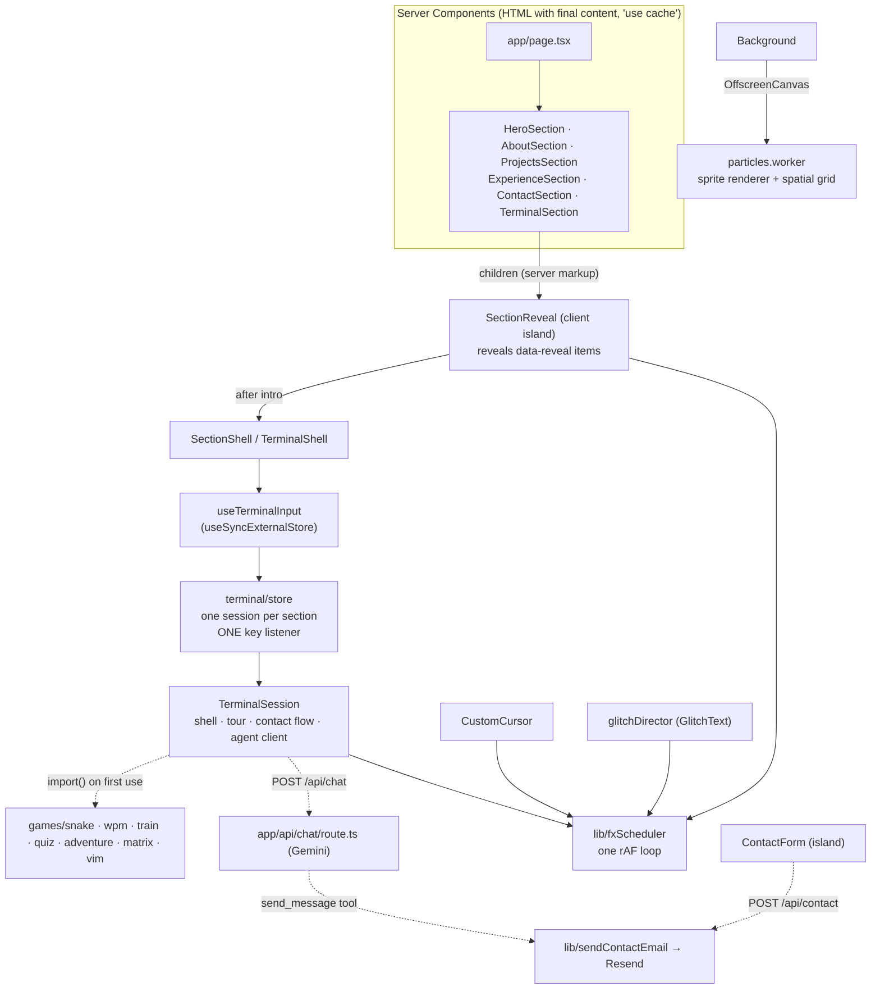
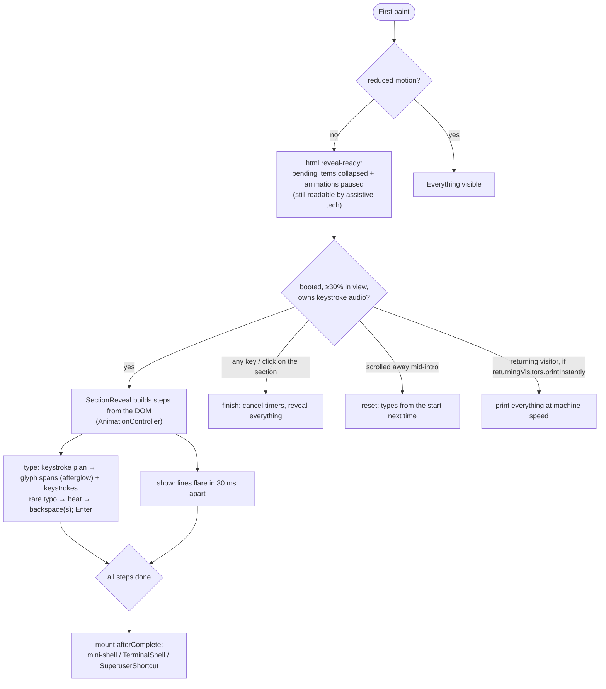
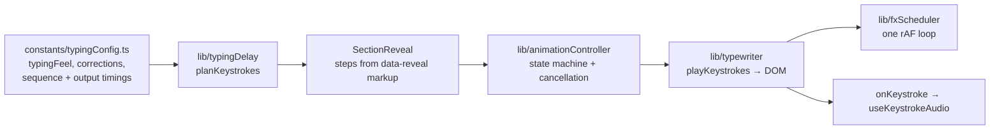
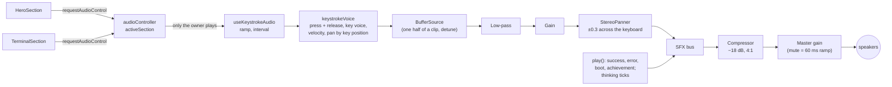
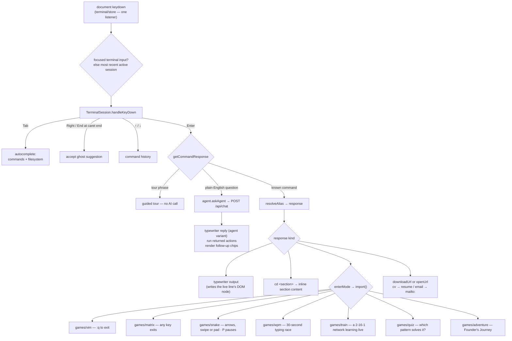
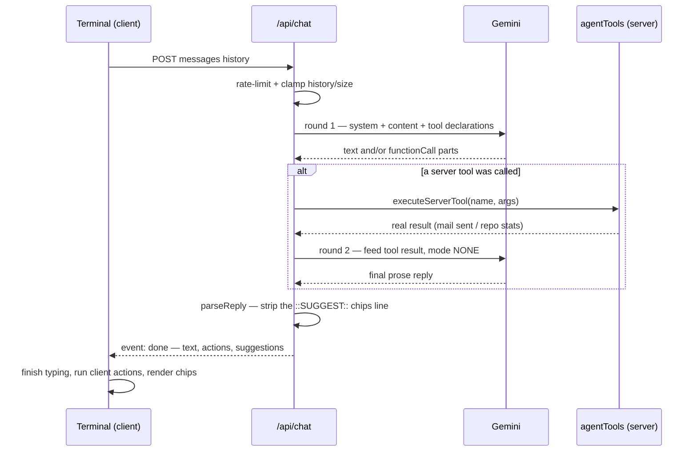
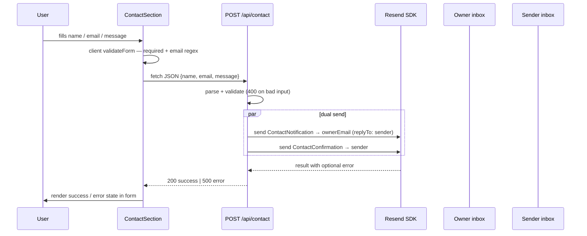
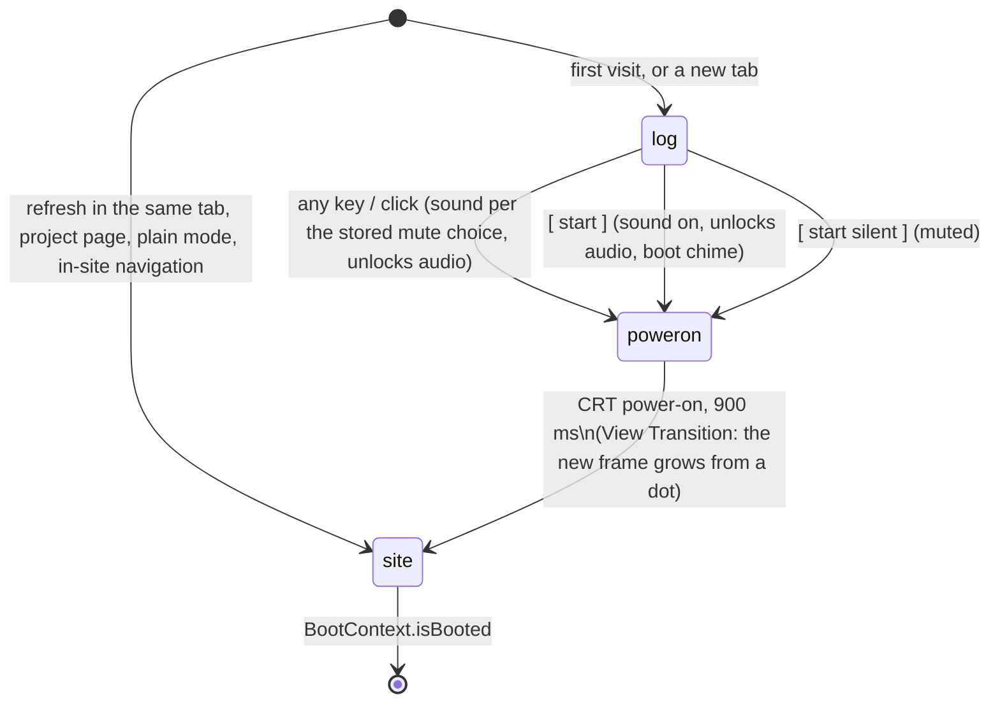
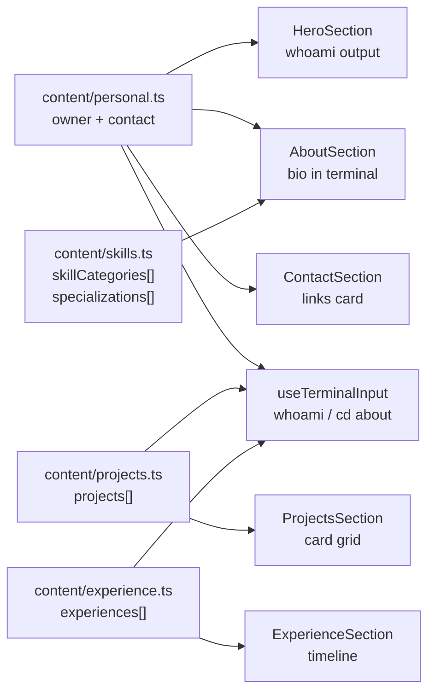

# my-portfolio

A terminal-themed personal portfolio for **Kudzai Prichard Matizirofa**, built as a Next.js 16 / React 19 single-page experience. Every section renders as a typed-out shell session — phosphor green on dark, animated, interactive, and audible.

The site doubles as a working pseudo-OS: it boots, snaps between sections, accepts shell commands, ships games (Snake, a typing race, a live neural-network demo, a pattern quiz and a text adventure), an inline `vim` and a Matrix rain mode. None of that is decorative — the components, hooks, and animation engine were built to support it.

There is also a **plain mode** (`--no-tty`, top right) — the same content as a clean, fast page — and a **page per project** (`/projects/<slug>`).

The terminal is also **conversational**. A built-in AI agent (Google Gemini, grounded on this site's own content and speaking in the first person as Kudzai; its replies stream in as they are generated) answers plain-English questions, *acts* on them through function calling — scrolling to sections, downloading the CV, opening links, running safe commands, fetching live GitHub stats, even taking a message to Kudzai's inbox — and can be driven entirely **by voice** (mic in, spoken replies out) where the browser supports it.

> The git history is the source of truth. This README explains structure and intent; for *why a specific change exists*, read the commit.

---

## Table of contents

1. [Tech stack](#tech-stack)
2. [Quick start](#quick-start)
3. [Environment variables](#environment-variables)
4. [Repository layout](#repository-layout)
5. [Architecture overview](#architecture-overview)
6. [Section anatomy](#section-anatomy)
7. [Hook dependency map](#hook-dependency-map)
8. [The animation pipeline](#the-animation-pipeline)
9. [Typing config reference](#typing-config-reference)
10. [Audio system](#audio-system)
11. [Interactive terminal](#interactive-terminal)
12. [Terminal AI agent](#terminal-ai-agent)
13. [Voice interaction](#voice-interaction)
14. [Contact form & email pipeline](#contact-form--email-pipeline)
15. [Boot screen & scroll model](#boot-screen--scroll-model)
16. [Content data model](#content-data-model)
17. [Styling & theming](#styling--theming)
18. [Accessibility](#accessibility)
19. [SEO](#seo)
20. [Customising the content](#customising-the-content)
21. [Plain mode, project pages and agents](#plain-mode-project-pages-and-agents)
22. [Deployment & CI](#deployment--ci)
23. [Things to know before contributing](#things-to-know-before-contributing)

---

## Tech stack

| Layer            | Choice                                                                           |
|------------------|----------------------------------------------------------------------------------|
| Framework        | **Next.js 16** (App Router, `app/` directory, **Cache Components** — section content is prerendered with `'use cache'`) |
| UI runtime       | **React 19**. Sections are **Server Components**; interactivity lives in small client islands. **React Compiler** (`reactCompiler: true`) memoizes automatically — there is no hand-written `useCallback`/`useMemo`. |
| Language         | **TypeScript 5** (strict mode, `@/*` path alias to repo root)                    |
| Styling          | Custom CSS (CSS custom properties, five switchable themes) + per-component scoped `<style>` blocks. No CSS framework. |
| Fonts            | **JetBrains Mono** + **VT323** via `next/font/google` |
| Email            | **Resend** + `@react-email/components` for the contact pipeline                  |
| AI agent         | **Google Gemini** (AI Studio REST API: `streamGenerateContent?alt=sse`, with `generateContent` as the fallback) behind a server-only `/api/chat` route that streams Server-Sent Events — function calling, grounded on the site's own content. No SDK; called over `fetch`. |
| Rate limits      | **Upstash Redis** (`@upstash/ratelimit`, via the Vercel Marketplace) — shared across instances; in-memory fallback in development |
| Voice            | Browser-native **Web Speech API** — speech recognition (mic → text) + speech synthesis (spoken replies). English-only, feature-detected, no dependency. |
| Lint             | `eslint-config-next` (core-web-vitals + typescript)                              |
| Tests            | **Vitest** (unit, `tests/unit/`) + **Playwright** (end-to-end smoke, `tests/e2e/`) |
| CI               | **GitHub Actions** (`.github/workflows/ci.yml`): lint, typecheck, Vitest, Knip, build, Playwright, **Lighthouse CI** with budgets (`lighthouserc.json`) |
| Dead-code check  | **Knip** (`npm run knip`) — unused files, exports and dependencies               |
| Analytics        | **Vercel Analytics** + **Speed Insights**, plus custom events in `src/lib/analytics.ts` |
| Node             | `20.x` (pinned in `package.json` `engines`)                                      |

There is **no Storybook**, **no state-management library** (the terminal store is a small `useSyncExternalStore` class), and **no UI kit**. Everything rendered on screen is hand-built from primitives in `src/`.

---

## Quick start

```bash
# Install
npm install

# Run dev server (http://localhost:3000)
npm run dev

# Production build
npm run build
npm run start

# Type-check without emitting
npm run typecheck

# Live check of Gemini streaming + tool calls on every model in the fallback chain (needs GEMINI_API_KEY)
npm run check:gemini

# Lint
npm run lint

# Unit tests (Vitest) and the end-to-end smoke test (Playwright; starts its own dev server on :3100)
npm test
npm run test:e2e        # first run: npx playwright install chromium
# …or against a server that's already running (e.g. your own `npm run dev`):
E2E_BASE_URL=http://localhost:3000 npm run test:e2e

# Bundle report (webpack build; opens treemaps)
ANALYZE=true npm run build -- --webpack

# Find unused files, exports and dependencies
npm run knip

# Regenerate the OG image (public/og-image.png) from the inline SVG
# Requires `sharp` to be installed locally.
node scripts/generate-og.mjs
```

Copy the env template and fill in your values:

```bash
cp .env.example .env.local
```

Everything degrades gracefully when keys are missing:

- **No `RESEND_API_KEY`** → the contact form and the agent's `send_message` tool report a friendly failure (the route no longer hard-500s the page).
- **No `GEMINI_API_KEY`** → the AI agent politely says it's offline and points visitors to `help`/`email`; the rest of the terminal works untouched.
- **No Upstash Redis** → rate limits fall back to per-instance memory (fine for development; provision Redis for production).

The boot screen, animations, games, and the full command-driven terminal all run with zero environment configuration.

---

## Environment variables

A documented template lives at **`.env.example`** — `cp .env.example .env.local` and fill it in. All public values use the `NEXT_PUBLIC_` prefix and are inlined at build time. `RESEND_API_KEY`, `GEMINI_API_KEY`, and `GITHUB_TOKEN` are server-only and never reach the client bundle.

| Variable                       | Used by                                  | Notes |
|--------------------------------|------------------------------------------|-------|
| `NEXT_PUBLIC_SITE_URL`         | `app/layout.tsx`, `sitemap.ts`, `robots.ts`, `StructuredData` | Canonical URL for OG/Twitter cards, sitemap, JSON-LD (read through `src/lib/site.ts`). Defaults to `https://prichard.co.zw`. **Set this in production** — every link that references itself derives from it. |
| `NEXT_PUBLIC_EMAIL`            | `app/api/contact/route.ts`, `src/lib/sendContactEmail.ts`, `src/content/personal.ts` | Owner email — recipient for contact-form notifications **and** the `replyTo` address, so replying in your mail client goes directly to the sender. Also required for the agent's `send_message` tool. |
| `RESEND_API_KEY`               | `src/lib/sendContactEmail.ts` (via `/api/contact` and the agent) | **Server-only.** Without it, both the contact form and the agent's message tool report a friendly failure. |
| `GEMINI_API_KEY`               | `app/api/chat/route.ts`                  | **Server-only.** Powers the terminal AI agent. Free key from [Google AI Studio](https://aistudio.google.com/app/apikey). If unset, the agent replies that it's offline — the terminal still works. **Never** prefix with `NEXT_PUBLIC_`. |
| `GEMINI_MODEL`                 | `app/api/chat/route.ts`                  | Optional model override. Defaults to `gemini-2.5-flash-lite`. The route also keeps an internal fallback chain (see [Terminal AI agent](#terminal-ai-agent)). |
| `GITHUB_TOKEN`                 | `src/lib/agentTools.ts`                  | **Optional, server-only.** Raises the GitHub API rate limit (60→5000/hr) for the agent's `get_repo_stats` tool. Works unauthenticated without it. |
| `UPSTASH_REDIS_REST_URL` / `UPSTASH_REDIS_REST_TOKEN` (or the Marketplace's `KV_REST_API_URL` / `KV_REST_API_TOKEN`) | `src/lib/rateLimit.ts` | **Server-only.** Shared rate limits for `/api/chat`, `/api/contact` and `/api/agent-tool`. Without them the limits are in-memory per instance. Add Upstash from the Vercel Marketplace and the variables are set for you. |
| `NEXT_PUBLIC_GITHUB_URL`       | `personal.ts`, `StructuredData`          | Full URL e.g. `https://github.com/kudzaiprichard` |
| `NEXT_PUBLIC_LINKEDIN_URL`     | `personal.ts`, `StructuredData`          | |
| `NEXT_PUBLIC_TWITTER_URL`      | `personal.ts`, `StructuredData`          | |
| `NEXT_PUBLIC_GITHUB_HANDLE`    | `personal.ts` (display)                  | e.g. `@kudzaiprichard` |
| `NEXT_PUBLIC_TWITTER_HANDLE`   | `personal.ts`, `app/layout.tsx`          | Used as Twitter card `creator` and displayed on the Contact card. |
| `NEXT_PUBLIC_LINKEDIN_NAME`    | `personal.ts`                            | Display label for LinkedIn link. |
| `NEXT_PUBLIC_RESUME_URL`       | `personal.ts` (used by terminal `cv` cmd) | If unset, falls back to `/resume.pdf`. External URLs open in a new tab; same-origin paths trigger `download` attribute. |

A `.env.local` is used locally — strip the API keys before pushing anywhere shared.

---

## Repository layout

```
my-portfolio/
├── app/                              # Next.js App Router root
│   ├── api/chat/route.ts             # POST handler — the agent: rate limit, clamp, SSE or JSON reply
│   ├── api/contact/route.ts          # POST handler — spam guard + rate limit over lib/sendContactEmail
│   ├── api/agent-tool/route.ts       # POST handler — server tools for WebMCP (get_repo_stats, send_message)
│   ├── projects/[slug]/page.tsx      # One static page per project
│   ├── llms.txt/route.ts             # /llms.txt — plain-text summary for AI agents
│   ├── globals.css                   # The five themes, motion tokens, snap-scroll, section-reveal rules, CRT keyframes and view transitions
│   ├── layout.tsx                    # Root layout, metadata, reveal-ready <head> script, ambient layers
│   ├── page.tsx                      # Server component: the six sections + VoiceProvider + SectionKeyNav
│   ├── robots.ts                     # /robots.txt generator
│   └── sitemap.ts                    # /sitemap.xml: home, project pages, llms.txt ('use cache')
│
├── scripts/
│   ├── generate-og.mjs               # Renders public/og-image.png from inline SVG (via sharp)
│   ├── check-gemini-stream.mjs       # npm run check:gemini — streaming + tools on every model
│   └── embed-sounds.mjs              # assets/sounds/*.mp3 → src/lib/keystrokeClips.ts (base64)
│
├── src/
│   ├── components/
│   │   ├── layout/                   # Cross-cutting layout chrome (client)
│   │   │   ├── Background.tsx        # Gradient + grid + particle canvas (worker driver)
│   │   │   ├── BootScreen.tsx        # First-visit BIOS log → CRT power-on; [ start ] / [ start silent ]
│   │   │   ├── TmuxBar.tsx           # tmux-style page indicator (channel change on click)
│   │   │   ├── CrtShader.tsx         # Opt-in WebGL tube over the hero and boot screen
│   │   │   ├── CustomCursor.tsx      # Section-aware cursor (dot/ring/caret), mouse pointers only
│   │   │   ├── ScrollHint.tsx        # Up/down scroll indicators
│   │   │   ├── SectionKeyNav.tsx     # #home default hash + arrow-key section paging
│   │   │   ├── context/BootContext.tsx
│   │   │   └── seo/StructuredData.tsx # JSON-LD ProfilePage + Person + Organization + WebSite
│   │   │
│   │   ├── sections/                 # The six full-viewport sections (Server Components)
│   │   │   ├── HeroSection.tsx
│   │   │   ├── AboutSection.tsx
│   │   │   ├── ProjectsSection.tsx
│   │   │   ├── ExperienceSection.tsx
│   │   │   ├── ContactSection.tsx
│   │   │   ├── contact/              # ContactForm + SuperuserShortcut (client islands)
│   │   │   ├── TerminalSection.tsx
│   │   │   └── terminal/TerminalShell.tsx # Full interactive shell + modes (client)
│   │   │
│   │   └── shared/
│   │       ├── reveal/               # SectionReveal (client island), TypedLine, SectionShell
│   │       ├── AgentOrb.tsx          # Canvas voice-bars visualizer for the AI agent presence
│   │       ├── GlitchText.tsx        # Text that glitches (per-character overlays; lib/glitchDirector)
│   │       ├── KeycapFeedback.tsx    # Enter keystroke on every button press
│   │       ├── PlainModeToggle.tsx   # The visible --no-tty switch
│   │       ├── CvLink.tsx            # [ download CV ] on the first screen
│   │       ├── WebMcpTools.tsx       # Registers the agent tools for browser agents (WebMCP)
│   │       ├── AudioSetup.tsx        # Installs the audio engine (gesture unlock, mute sync)
│   │       ├── MuteToggle.tsx        # Persists to localStorage, broadcasts via CustomEvent
│   │       ├── ScrollSection.tsx     # Wraps a section, syncs URL hash on intersect
│   │       ├── TerminalContainer.tsx # The 3-dot framed CRT box every section uses
│   │       ├── TerminalInput.tsx     # History + live line + real <input> prompt, mic, chips
│   │       ├── ThemePicker.tsx       # Theme menu beside the mute toggle
│   │       ├── VoiceProvider.tsx     # Page-wide shared useVoice instance (React context)
│   │       └── email-templates/      # ContactConfirmation + ContactNotification (+ index)
│   │
│   ├── terminal/                     # The shell, framework-free
│   │   ├── session.ts                # TerminalSession: state machine, typing, agent, tour, contact flow
│   │   ├── store.ts                  # One session per section + the page's single key listener
│   │   ├── types.ts · sections.ts    # Shared types · `cd <section>` text and timings
│   │   ├── format.ts                 # Boxed output blocks (┌─ │ └──) for cd and cat
│   │   ├── fs.ts                     # Fake ~ filesystem + ls/cd/cat/pwd
│   │   ├── agent.ts                  # /api/chat client + agent action side-effects
│   │   ├── tour.ts                   # Guided tour, onboarding replies, contact triggers
│   │   ├── commands/                 # index (dispatcher), aliases, suggest, system, network, git, fun, help
│   │   └── games/                    # snake, wpm, train, quiz, adventure, matrix, vim — loaded with import() on first use
│   │
│   ├── constants/
│   │   ├── typingConfig.ts           # SINGLE source of truth for all typing feel and sequence timings
│   │   ├── glitchConfig.ts           # How often and how hard text glitches
│   │   └── bootConfig.ts             # Boot pacing + the returning-visitor key
│   │
│   ├── content/                      # Site copy & data — edit these to make it yours
│   │   ├── personal.ts               # owner + contact (env-driven)
│   │   ├── projects.ts               # Project[] with its own Project interface
│   │   ├── experience.ts             # Experience[] with its own Experience interface
│   │   ├── skills.ts                 # SkillCategory[] + specializations[]
│   │   └── index.ts                  # Re-exports
│   │
│   ├── hooks/
│   │   ├── useSectionAnimation.ts    # Shared section lifecycle: audio ownership, start, finish/skip, reduced motion, plain mode
│   │   ├── useAnimationController.ts # React wrapper around lib/animationController
│   │   ├── useKeystrokeAudio.ts      # Per-section keystroke ramp, panning and sample choice
│   │   ├── useInView.ts              # IntersectionObserver wrapper
│   │   ├── useReducedMotion.ts       # prefers-reduced-motion (useSyncExternalStore)
│   │   ├── useTerminalInput.ts       # React view onto a section's TerminalSession
│   │   └── useVoice.ts               # Web Speech API: mic recognition + speech synthesis
│   │
│   ├── lib/                          # Framework-agnostic utilities
│   │   ├── aiAgent.ts                # Agent "brain": persona, grounding, tool decls, parsing (server-safe, no secrets)
│   │   ├── gemini.ts                 # Server-only: Gemini streaming + fallback, round-trip, model chain
│   │   ├── agentTools.ts             # Server-side tool execution (send_message, get_repo_stats)
│   │   ├── rateLimit.ts              # Shared rate limits (Upstash Redis; in-memory fallback)
│   │   ├── spamGuard.ts              # Honeypot + minimum fill time for both message paths
│   │   ├── projectDocs.ts            # A project's write-up for its page and the terminal README
│   │   ├── sendContactEmail.ts       # Shared contact-send used by /api/contact AND the agent
│   │   ├── animationController.ts    # Imperative step-runner with cancellation
│   │   ├── animationTypes.ts         # Animation/audio interfaces
│   │   ├── audioController.ts        # Global "which section owns the audio" arbiter
│   │   ├── audioEngine.ts            # Web Audio graph: clips, synthesised sounds, mute, mic meter
│   │   ├── analytics.ts              # Custom Vercel Analytics event names + trackEvent()
│   │   ├── fxScheduler.ts            # The one requestAnimationFrame loop (onFrame / after / every)
│   │   ├── fxState.ts                # Reasons to pause ambient effects (boot, games, plain mode)
│   │   ├── plainMode.ts              # --no-tty: state, persistence, effects, suggested theme
│   │   ├── achievements.ts           # The eleven achievements (games + easter eggs), live count for the tmux bar
│   │   ├── screenReaderStore.ts      # screenreader on/off: mirror output into a live region
│   │   ├── themes.ts                 # Theme ids, names, aliases and palettes
│   │   ├── themeStore.ts             # Apply / persist / subscribe to the active theme
│   │   ├── typewriter.ts             # Frame-driven typewriter that writes straight into DOM nodes
│   │   ├── typingDelay.ts            # Delay model + keystroke plans (rare typos, Enter)
│   │   ├── keyboard.ts               # QWERTY geometry: finger, hand, Shift, key position
│   │   ├── keystrokeVoice.ts         # How one key sounds: press + release, voice, velocity, pan
│   │   ├── viewTransition.ts         # runTransition('chan' | 'crton', update)
│   │   ├── sectionNav.ts             # goToSection(): the channel change between sections
│   │   ├── crtStore.ts               # crt on/off: state, persistence, the command's text
│   │   ├── glitchDirector.ts         # Picks and plays the glitches on every GlitchText
│   │   ├── skipHint.ts               # First-time "press any key to skip" flag
│   │   └── particles/                # physics, field (sprite renderer), particles.worker, messages
│   │
│   └── types/
│       └── index.ts                  # Shared component prop types
│
├── tests/                            # unit/ (Vitest) and e2e/ (Playwright)
├── public/
│   └── favicon.* / og-image.png / site.webmanifest / web-app-manifest-*.png
│
├── .env.example                      # Documented env template — copy to .env.local
├── eslint.config.mjs
├── next.config.ts                    # cacheComponents, reactCompiler, bundle analyzer
├── knip.json                         # Knip entry points (scripts/*.mjs)
├── vitest.config.mts                 # Unit tests in tests/unit/
├── playwright.config.ts              # Smoke test in tests/e2e/ (E2E_BASE_URL to reuse a server; CI uses next start)
├── lighthouserc.json                 # Lighthouse CI collection + budgets
├── .github/workflows/ci.yml          # CI: lint, types, tests, Knip, build, Playwright, Lighthouse
├── tsconfig.json                     # @/* → ./*
└── package.json
```

---

## Architecture overview

The page is a **Server Component** tree. Each section prints its *final* content into the HTML — the text a visitor eventually sees is there before any JavaScript runs, so crawlers, screen readers and no-JS visitors get all of it. Client code lives in small islands:

- **`SectionReveal`** (one per section) reveals that server-rendered content like a terminal session — a person types the commands, the machine prints the output line by line — then mounts the section's shell. Any key or click finishes it.
- **Terminals** (`SectionShell` on Hero/About/Projects/Experience, `TerminalShell` on `#terminal`) are React views onto framework-free `TerminalSession`s in `src/terminal/`.
- **Layout chrome** (boot screen, particle background, cursor, audio, the tmux page bar, the CRT shader, scroll hint, key navigation) lives in `app/layout.tsx` / `SectionKeyNav`.

Everything that moves runs on **one animation-frame loop** (`lib/fxScheduler`), and the particle field renders in a **Web Worker** on an OffscreenCanvas.



---

## Section anatomy

A section is server markup annotated for `SectionReveal`:

| Markup | Meaning |
|---|---|
| `<TypedLine text="whoami" … />` → `data-reveal="type"` | A command typed out with human timing and keystroke audio. The full text is in the HTML; typing writes into a sibling live node. |
| `data-reveal="show"` | Machine output: its lines (its child elements, or the block itself if it has its own text) print ~30 ms apart, each with the `lnin` flare. |
| `data-delay` | Pause before that step: a `sequenceTimings` key (`dramaticPause`, `postCommandDelay`, …) or `"0"`. Defaults come from `sequenceTimings`. No millisecond values in components. |



---

## Hook dependency map

| Consumer | useSectionAnimation | useTerminalInput | useReducedMotion | useVoiceContext |
|---|:---:|:---:|:---:|:---:|
| SectionReveal | ✓ | | (via hook) | |
| SectionShell (Hero/About/Projects/Experience) | | ✓ (mini) | | ✓ |
| TerminalShell | | ✓ (full) | | ✓ |
| CustomCursor · Background · AgentOrb | | | ✓ | |

`useSectionAnimation` composes `useInView`, `useKeystrokeAudio`, `useAnimationController` and `useReducedMotion` into the shared lifecycle: claim the keystroke channel while in view (and reclaim it whenever another section frees it), start when booted, finish instantly when skipped or scrolled away, print instantly for returning visitors if `returningVisitors.printInstantly` is on (off by default), reveal everything under reduced motion, release audio on unmount.

**`useVoice`** is instantiated once by `VoiceProvider` (in `app/page.tsx`) and shared via context, so every terminal reads the *same* voice instance.

---

## The animation pipeline



- **`constants/typingConfig.ts`** is the *only* place to change typing feel: the delay model, corrections, per-section speed, output line timing, audio ramp settings, and sequence timings.
- **`lib/typingDelay.ts`** turns a line into a *keystroke plan*: each step is `{ delay, visible, key }`, including the odd correction (`'\b'` is backspace) and, for typed commands, a final Enter (`'\n'`). Finger, hand and Shift come from **`lib/keyboard.ts`**.
- **`lib/animationController.ts`** runs `AnimationStep[]` (`{ action, duration }`) with clean cancellation — every timer is recorded and cleared on `cancel()`.
- **`lib/typewriter.ts`** plays a keystroke plan on the shared frame loop (`playKeystrokes`) and hands each key to a writer that edits the DOM directly — React never re-renders per character. Each typed glyph is a `<span class="k">` that lands white-hot and cools (`phos`, 520 ms). Agent replies use `typewrite` (constant rate); command output in the terminals streams line by line.
- **`lib/fxScheduler.ts`** is the single `requestAnimationFrame` loop for the cursor, the glitch director, typewriters, the CRT shader and the main-thread particle fallback; `after(ms)` / `every(ms)` give frame-aligned timers.

### Reduced-motion path

The `<head>` script doesn't add `reveal-ready`, so nothing is hidden; `SectionReveal` marks every item revealed immediately and completes. The glitch, scanlines, the CRT shader, standby dimming, view transitions, the particle loop (one static frame), the cursor trail and boot animations also short-circuit, and a `globals.css` rule compresses every `*` animation/transition to 0.01 ms.

---

## Typing config reference

All values live in `src/constants/typingConfig.ts` (from the Phosphor review's `newDelay()`):

### The delay model (`typingFeel`)

| Rule | Value |
|------|-------|
| Base delay per character | **52 ms** |
| First letter of a word | ×1.6 (the pause lives at the start of each word) |
| Common letter pair (`th he in er an re on at en nd st es or te ti is it ar ca ls ro ol le xt pr …`) | ×0.6 |
| Otherwise: the same key twice (`ll`) | ×0.75 (a double tap) |
| Otherwise: the same finger, another key (`ed`, `un`, `ce`) | ×1.3 |
| Otherwise: the other hand | ×0.85 |
| Capitals and shifted symbols | ×1.25 (Shift) |
| Space | `d × 0.8 + 40–100 ms` (thumb beat) |
| `. / - _` | ×1.35 |
| Jitter | log-normal, `× e^(0.25·z)` clamped to 0.65–2: mostly quick, now and then a slow stroke |
| A word starting with `- . ~ /` (a flag or a path) | + 120–260 ms hesitation |
| Rollover (a pair across the two hands) | 12% chance the key lands 12–28 ms after the last |
| Enter at the end of a typed command | after a 180–340 ms beat to read the line |

### Rare corrections (`corrections`)

2–4% (`probability: 0.03`) per eligible letter, at most one per line, never in the first 4 characters or inside a capitalised word (names). Four kinds, by weight:

| Kind | Weight | What happens |
|------|--------|--------------|
| `neighbour` | 0.45 | a neighbouring QWERTY key (`NEIGHBOUR_KEYS`), a 170–280 ms beat, backspace, the right key 80 ms later |
| `late` | 0.25 | a neighbouring key, noticed only after 1–3 more keys: a quick burst of backspaces (55 ms apart), then retyped |
| `swap` | 0.15 | two letters in the wrong order ("teh"): two backspaces, both retyped |
| `double` | 0.15 | one letter twice, one backspace |

Every backspace plays its own sound.

### Per-section feel

| Section | `speedScale` | Corrections |
|---------|-------------|-------------|
| `hero` | 1 | yes |
| `about` | 0.95 | yes |
| `projects` | 1 | yes |
| `experience` | 1 | yes |
| `contact` | 1 | no |
| `terminal` (banner, `cd` status lines) | 0.5 | no |

### Machine output (`outputTimings`)

| Timing | Value |
|--------|-------|
| One output line | **30 ms**, each with the `lnin` flare (360 ms) |
| Blank line / section rule | 70 ms |
| Agent reply (still typed) | 18 ms per character |

### Sequence timings (`sequenceTimings`)

| Timing | Value |
|--------|-------|
| Before the first command | 200 ms |
| After Enter, before the command's output | 90 ms |
| Output → next command | 200 ms |
| Between consecutive output blocks | 30 ms |
| `dramaticPause` (projects footer, superuser prompt) | 600 ms |

The hero types out in about 3 s once the boot is started (any key skips it). With the boot's `autoContinue` on, a first visit measured on a production build is fully readable about **4.8–5.4 s** after landing; with `returningVisitors.printInstantly` and `skipForReturningVisitors` on, a returning visitor in about **0.5 s**. Both are off by default, for the full experience.

### Skip

Any key or a click on the section itself finishes the running intro at once. Modifier keys, Tab and the navigation keys (arrows, Page Up/Down, Home, End, Space) don't, and nor do clicks on the page chrome (tmux bar, theme picker, mute). The first intro shows a dim `# press any key to skip`; `localStorage['portfolio-skip-hint-seen']` hides it afterwards.

**Leaving mid-intro** (`sectionStart.onScrollAway`, `'restart'`): a section left before it finished is reset, and types from the beginning when the visitor comes back. `'finish'` completes it instead.

**Waiting for sound** (`sectionStart.waitForSound`, on): browsers block audio until the visitor clicks or presses a key, and a refresh resets that. When a section is about to type while sound is still blocked, it waits, caret blinking, with `# press any key or click to start ▸`; the first gesture unlocks the audio and the typing starts, heard. It never waits when sound is muted, in plain mode or under reduced motion.

### Audio config (also in `typingConfig.ts`)

| Setting | Value |
|---------|-------|
| `baseVolume` | 0.4 |
| `volumeRampEnabled` | true |
| `volumeRampKeystrokes` | 10 (ramp from 50% → 100% of baseVolume) |
| `volumeDecayDelayMs` | 2 000 ms of silence triggers decay |
| `volumeDecayFactor` | 0.5 (halves the ramp progress) |

---

## Audio system

Every sound goes through one Web Audio engine, **`src/lib/audioEngine.ts`** (the `audioEngine` singleton). There are no `<audio>` elements and **no audio files are requested at all**: the four keystroke clips (17 KB of MP3) are embedded as base64 in `src/lib/keystrokeClips.ts`, loaded in their own small chunk, because download-manager tools (e.g. Internet Download Manager) pop up a "download this audio" button for every audio file a page fetches. The source clips live in `assets/sounds/`; after changing one, run `node scripts/embed-sounds.mjs`. Every interface sound is synthesised. There is no background sound.



- **Unlock.** The `AudioContext` is created inside the first `pointerdown` / `keydown` / `touchstart` (iOS requires a gesture). The boot screen's two buttons, **`[ start ]`** and **`[ start silent ]`**, are both that gesture and the sound-consent choice: start unmutes and plays the boot chime, start silent mutes.
- **Keystrokes.** The four embedded clips are loaded as the page opens and decoded once into `AudioBuffer`s when audio unlocks. Each recording holds a key going down and, about 100 ms later, coming back up; `KEY_CLIP_PARTS` in `audioEngine.ts` records where each half sits, and `lib/keystrokeVoice.ts` (tuned by `keySound` in `typingConfig.ts`) plays them separately:
  - **Press, then release** 70–140 ms later (the gap varies like a real finger), each half a `BufferSource` with a short fade at the cut, a `detune` (a real pitch change, unlike `playbackRate` on `<audio>`), a low-pass for tone, a `GainNode` (which works on iOS, where `HTMLMediaElement.volume` is read-only) and a `StereoPanner`.
  - **Each key keeps its own voice** for the visit: one of the clips, a pitch within ±22 cents and a tone of 5–11 kHz; each press varies only ±7 cents and ±1.5 dB around it.
  - **The big keys:** the space bar is deeper (−260 cents, 2.6 kHz) with a short stabiliser rattle and a later release; Enter is a firm press (−120 cents, ×1.15); Backspace is a little brighter.
  - **Force follows speed:** a key 60 ms or less after the last lands at ×0.78, a steady 220 ms at ×1, the first after a 700 ms pause at ×1.12.
  - **Stereo by key position:** keys pan by where they sit on a QWERTY board, from −0.3 (left edge) to +0.3 (right edge).
- **Volume ramp.** `useKeystrokeAudio` keeps the ramp from `typingConfig.ts`: the first 10 strokes after `resetVolumeRamp()` rise from 50% to 100% of `baseVolume`, and after 2 s of silence the ramp decays by half so a new burst starts softer.
- **One owner.** `audioController` still decides which section owns the keystroke channel; the others' strokes are silent.
- **Palette.** Each interface sound means one thing (the games add a soft `blip` and a gentle `gameover` fall), and all sit within a few dB of each other: `success` (two rising sines: a sent message), `error` (two falling soft triangle notes: `bash: … command not found`, a failed form), a quiet two-note sine **pulse** every 420 ms while the agent is thinking, the **boot** chime (C–G–C), an **achievement** chime, and in the terminal a soft **load** swell (a triangle gliding G4 → D5 with an octave shimmer) when `cd <section>` or a command with a loading spinner starts fetching, answered by a gentle two-note **loaded** bell (D5, A5) when the data has printed (or the visitor skips ahead).
- **No background sound.** The page has no ambient hum or music: visitors found the old CRT hum (filtered noise over a 55 Hz drone) irritating, and a softer synthesised pad that replaced it was removed too. The only audio is the keystrokes, the interface sounds above and the agent's voice. `AudioSetup` (mounted in the layout) installs the engine.
- **Mute.** `localStorage['keystroke-audio-muted']`, toggled by `MuteToggle` or the boot buttons through `setAudioMuted()`, which also dispatches `CustomEvent('audio-mute-change')` for this tab. Other tabs follow via the `storage` event. Muting ramps the master gain to 0 in about 60 ms.
- **Mic meter.** While voice input is listening, `useVoice` starts `audioEngine.startMicMeter()`: a `getUserMedia` stream feeding an `AnalyserNode` (never routed to the speakers). `AgentOrb` reads `getMicLevel()` each frame, so its bars follow the visitor's voice. Under reduced motion the orb stays frozen as before.

---

## Interactive terminal

The shell lives in **`src/terminal/`**, free of React. Each section gets a **`TerminalSession`** (`session.ts`) holding all state — history, input, modes, the tour, the contact flow and the client half of the AI agent — published as immutable snapshots that `useTerminalInput` reads with `useSyncExternalStore`. **`store.ts`** creates the sessions and installs the page's **single keyboard listener**: keys go to the session whose input has focus, otherwise to the most recently activated terminal (a section becomes active once its intro has finished and it is in view). Only **`#terminal`** exposes the full command set; the other sections run reduced mini-shells.

Every `Enter` is resolved by `getCommandResponse` (`commands/index.ts`): a tour phrase launches the guided tour with no AI call, a recognised command (or close typo) goes to the normal dispatcher, and plain-English input is routed to the AI agent.



### Full command reference

Commands are registered in `getCommandResponse()` and surfaced via `help`.

| Category | Commands |
|----------|----------|
| **Navigation** | `cd home\|about\|projects\|experience\|contact` — renders section content inline |
| **Filesystem** | `ls`, `ls -l`, `ls -la`, `pwd`, `cat <file>`, `cd <dir>` |
| **System** | `whoami`, `neofetch`, `htop`, `kill <proc>`, `date`, `history`, `man <topic>`, `echo <text>` |
| **Network** | `ping <host>`, `ssh <host>`, `curl <args>`, `sudo <cmd>` |
| **Git** | `git log`, `git blame` (aliases: `hist`, `annotate`) |
| **Reach-out** | `cv` (downloads resume), `email` (opens `mailto:` with pre-filled subject) |
| **Games** | `games` (the menu), `snake`, `wpm`, `train`, `quiz`, `adventure` (aliases: `play`, `race`, `ml`, `interview`, `journey`) |
| **Fun** | `vim` / `vi` / `nano`, `ascii`, `matrix`, `sl` |
| **AI / guide** | `tour` (guided walkthrough) — plus any plain-English question, routed to the AI agent |
| **Utility** | `help` / `?` / `commands`, `clear`, `exit`, `settings`, `theme [name]`, `crt [on\|off]`, `screenreader [on\|off]` (`sr`), `--no-tty` / `plain` and `tty`, `achievements` |

### Aliases and did-you-mean

`COMMAND_ALIASES` maps Windows/Mac names to canonical commands — `dir`, `type`, `notepad`, `runas`, `nvim`, `code`, `wget`, `screenfetch`, etc., all resolve. Unknown commands run through `findClosestCommand` for a `Did you mean: ?` suggestion before returning `bash: <cmd>: command not found`.

### Loading messages

Commands that feel "heavyweight" (`neofetch`, `htop`, `git log`, `ssh`, `sudo`, `curl`) show a sequence of fake loading lines before their real output, defined in `LOADING_SETS`. This is the right place to add fake telemetry for a new command.

### In-memory filesystem

The terminal keeps a fake `~` tree in `src/terminal/fs.ts`. The factual folders are **generated from `src/content/`**, so they always agree with the rest of the site: `projects/<slug>/README.md` (the same text as the project page, from `lib/projectDocs.ts`), `experience/*.log`, `skills/*.txt`, `personal/contact.txt` and `about.txt`. The fun files — `~/.secret`, the `.private/secrets/buried/deep` facts — stay hand-written.

### Inline mini-shell on non-terminal sections

Hero, About, Projects, and Experience mount a `SectionShell` after their intro completes, with a **reduced** command set (navigation, `whoami`, `help`, `clear`). Each has its own `TerminalSession` keyed by `sectionId`, and `getCommandResponse` switches on it.

### The prompt is a real input

The prompt is a visible `<input data-terminal-input>`, styled as terminal text. Screen readers, autocorrect, dictation, IME composition and mobile soft keyboards all work natively; tapping anywhere in the terminal focuses it. Typing with nothing focused still works — the key listener applies the key and moves focus into the input. Soft keyboards that don't send an Enter keydown submit the surrounding form, which is routed through the same handler.

---

## Terminal AI agent

Plain-English questions in the terminal are answered by an AI agent that speaks in the **first person as Kudzai**, is **grounded** on this site's own content (so it doesn't hallucinate a career), and can **act** — not just talk — through Gemini function calling. The browser never sees the model key: everything goes through the server-only `/api/chat` route.

### Three-file split

| File | Runs | Responsibility |
|------|------|----------------|
| `src/lib/aiAgent.ts` | server-safe, **no secrets** | The "brain": builds the system instruction (persona + guardrails), serializes the portfolio content into a grounded knowledge base, declares the tools, and parses the reply. Importable anywhere, unit-testable. |
| `app/api/chat/route.ts` | **server only** | Rate limiting, history clamping, and the reply format: Server-Sent Events (`Accept: text/event-stream`) or JSON. |
| `src/lib/gemini.ts` | **server only** | Talks to Gemini over `fetch`: streaming with fallback, the function-calling round-trip, the model chain. Reads `GEMINI_API_KEY`. |
| `src/lib/agentTools.ts` | **server only** | Executes the tools that need secrets or network (`send_message` via `sendContactEmail` — spam-guarded — and `get_repo_stats` via the GitHub API). |

### What the agent can do (tools)

Declared once in `TOOL_DECLARATIONS` (single source of truth). Each tool is either a **client action** (returned to the browser and mapped onto an existing terminal side-effect — no new execution path) or a **server tool** (executed during the round-trip, its real result fed back to the model).

| Tool | Kind | Effect |
|------|------|--------|
| `navigate_to_section` | client | Smooth-scroll the page to a section |
| `show_section` | client | Render a section inline (like `cd <section>`) |
| `download_resume` | client | Trigger the CV download (`cv`) |
| `open_link` | client | Open GitHub / LinkedIn / Twitter / email |
| `run_command` | client | Run a **whitelisted, read-only** command (`whoami`, `neofetch`, `ls`, `cat`, `cd`, `pwd`, `date`, `history`, `man`, `ascii`, `git log`, `git blame`) |
| `start_tour` | client | Launch the guided tour |
| `send_message` | **server** | Send a message to Kudzai's inbox (only after collecting name + valid email + message) |
| `get_repo_stats` | **server** | Fetch live GitHub stars / language / last-updated for a project (10-min cache) |

Raw Gemini `functionCall`s are validated and narrowed into a typed `AgentAction` union by `toAgentAction()`; unknown tool names, bad enum values, and non-whitelisted commands return `null` and are dropped (the model occasionally hallucinates). The client fires instant actions (navigate, open link, download) immediately and **defers** inline-render / `run_command` / `start_tour` until *after* the spoken reply finishes typing.

### The function-calling round-trip



**Streaming.** With `Accept: text/event-stream`, round 1 uses `:streamGenerateContent?alt=sse` and the route forwards `event: delta` messages as text arrives; the terminal starts typing the first words (instead of a spinner for the whole generation) and catches up at 18 ms per character. The suggestion marker never reaches the screen (`VisibleTextStream` holds back anything that could become `::SUGGEST::`). Function calls arrive as their own parts in the stream, so tools still run. If streaming fails before any text is shown — an error status, or a stream that ends empty (both reported on forums with function declarations on some models) — that round is retried on the plain `generateContent` endpoint. The final `event: done` reply is authoritative. `npm run check:gemini` tests streaming + a tool call on every model in the chain; `tests/unit/gemini.test.ts` covers the parser, the marker, fallback, model fallthrough and the guard with a mocked upstream.

Round 2 only runs when a server tool executed (so the reply reflects the real result) or the model called tools but produced no prose. It forces `functionCallingConfig.mode: NONE` so the model replies in words instead of looping, and it's wrapped in its own try/catch — if the confirmation wording fails, the round-1 actions are still returned rather than lost.

### Guardrails

- **Grounded, on-topic only.** The model answers from the injected knowledge base (built from `src/content/`), declines anything off-topic, and is told never to invent jobs, dates, metrics, or projects.
- **Prompt-injection resistant.** It's instructed to ignore any attempt (from the visitor or embedded text) to change its rules, reveal the system prompt, or impersonate a different assistant.
- **`run_command` is whitelisted** by prefix to safe read-only commands — `exit`, `clear`, and anything destructive are excluded.
- **Multilingual** — it replies in the visitor's language (including Shona/Ndebele), falling back to English when it can't answer accurately.

### Resilience & cost control (`route.ts`, `lib/gemini.ts`, `lib/rateLimit.ts`)

| Concern | Mechanism |
|---------|-----------|
| Per-IP abuse | 8 requests / minute / IP (sliding window, Upstash Redis — shared across instances) |
| Global free-tier cap | 200 agent requests / day across all visitors (fixed window, Redis) |
| Spam to the inbox | `send_message` and `/api/contact` need the page's guard (honeypot + 2.5 s minimum since page load, `lib/spamGuard.ts`) and allow 3 messages / IP / hour |
| Context flooding | History clamped to 12 turns, each message capped at 1000 chars |
| Model exhaustion / overload | `MODEL_CHAIN` fallback — on 429/500/503 it transparently retries the next model (`gemini-2.5-flash-lite` → `gemini-flash-latest` → `gemini-2.5-flash` → `gemini-2.0-flash`) |
| Latency / token waste | `thinkingBudget: 0` disables Gemini 2.5's internal thinking pass |
| No / bad key, quota hit | Never 500s the page — returns a friendly in-character message and points the visitor to `help` / `email` |

### Suggested follow-ups

The model ends every reply with a hidden `::SUGGEST:: q1 | q2 | q3` line. `parseReply()` strips it from the visible text and returns up to three short questions, which render as clickable chips below the input — phrased the way a visitor would type them. After the agent has answered once, recruiter-focused quick-action chips (`download CV`, `view projects`, `experience`, `get in touch`) are also available.

---

## Voice interaction

The terminal can be driven entirely by voice, built on the **browser-native Web Speech API** — no dependency, no third-party service. It's **English-only** and fully feature-detected: where the browser lacks support, `supported` is `false` and the mic affordance is hidden entirely.

- **One shared instance.** `useVoice` is created once by `VoiceProvider` (`app/page.tsx`) and shared via context, so the voice toggle stays consistent as the visitor scrolls between sections.
- **Recognition (mic → text).** Continuous mode with a **2-second silence finalizer**: the mic keeps listening across short pauses and only submits after ~2s of quiet (or when the visitor taps stop), so speakers aren't cut off mid-sentence. The live interim transcript is shown for feedback.
- **Synthesis (text → speech).** Replies are spoken aloud **only when the question was asked by voice** (tracked per-turn). It picks the smoothest available English voice (prefers neural/"Natural" on Edge, then Google voices on Chrome) and strips ASCII-art / prompt characters that read badly aloud.
- **Privacy.** One line next to the mic says it: voice input in Chrome sends the audio to Google for recognition.
- **The agent orb.** `AgentOrb.tsx` is a hand-built canvas "voice bars" visualizer (no library, `requestAnimationFrame`) that gives the agent a living presence. It has four states — `idle` (slow breathing), `thinking` (fast pulse), `speaking`, and `listening` — derived from terminal activity, inherits the terminal theme colour, and freezes to a static frame under `prefers-reduced-motion`.

---

## Contact form & email pipeline

Both paths to the inbox (the form / terminal `email` flow, and the agent's `send_message`) are protected without a third-party widget: a **honeypot** field people never see (a filled one gets a silent fake success), a **minimum time since page load** (2.5 s), and a **3 messages / IP / hour** limit in Redis.



- **Shared send path.** Both the form (`POST /api/contact`) and the agent's `send_message` tool call the same `src/lib/sendContactEmail.ts`, so the two routes can never drift apart. It validates server-side, sends both emails, and returns a structured `{ success, error? }` result instead of throwing. `app/api/contact/route.ts` is now a thin wrapper that maps that result to a 200 / 400 / 500.
- Both emails use `@react-email/components` templates (`src/components/shared/email-templates/`, re-exported via `index.ts`). They share a CRT-window aesthetic matching the site.
- The notification sets `replyTo` to the sender's email, so the owner can reply directly from their mail client.
- The `from` address is `noreply@prichard.co.zw` in `sendContactEmail.ts`. **Change this if you fork** — Resend requires a verified sending domain.
- The path does **not** persist messages anywhere. To keep a record, add a write to your store inside `sendContactEmail`.
- Client-side validation: required fields + `/^[^\s@]+@[^\s@]+\.[^\s@]+$/` for email. The same regex re-validates on the server. Field-level errors clear on edit.

### Easter egg

After Contact finishes animating, a `root@kudzai:~# press Enter to enter superuser mode` line appears. Pressing **Enter** while no form field is focused scrolls to `#terminal`. Modifier keys are ignored; any active `INPUT`/`TEXTAREA`/`BUTTON`/`SELECT`/`contentEditable` short-circuits the handler.

---

## Boot screen & scroll model

`BootScreen` shows **once per tab**: on the first visit and whenever the site is opened in a new tab. A refresh in the same tab goes straight to the sections typing out (`sessionStorage['portfolio-tab-booted']` survives a refresh, and a new tab starts empty). It also doesn't show when moving inside the site without a reload (e.g. a project page's "← all projects"), on deep links such as `/projects/<slug>`, or in plain mode.



- The BIOS log streams in (one line every 130 ms), then the boot **waits** for `[ start ]`, `[ start silent ]` or any key. Browsers only allow sound after a click or key press, so waiting is what lets the first section's typing be heard. The keystroke clips are downloaded as the page loads, so they're ready the moment audio unlocks.
- Settings in `constants/bootConfig.ts` (`bootBehaviour`): `oncePerTab` (on) is the rule above; `autoContinue` starts the site on its own 1.6 s after landing (the first section is then silent until the visitor interacts); `skipForReturningVisitors` hides the boot in every tab for browsers that have booted before (`localStorage['portfolio-booted']`). Skips are applied before paint as `html.booted` by the `<head>` script.
- After a refresh there is no boot click, and browsers block sound until the visitor clicks or presses a key, so the section on screen waits for that first key or click before it types (see **Waiting for sound** under [Typing config reference](#typing-config-reference)).
- **Power-on:** with View Transitions, `runTransition('crton', …)` (`lib/viewTransition.ts`) animates `::view-transition-new(root)` with the `crton` keyframes, so the whole screen — particles included — goes dot → line → picture. Without them, and on a page that skips the boot (`html.booted`), a full-screen tube overlay (`body::before`, `crt-cover`) plays the same shape. The page itself is never transformed, so section visibility is never fooled.
- Sections always type out after the boot, unless `returningVisitors.printInstantly` in `typingConfig.ts` is turned on (it only matters when the boot is skipped).
- `prefers-reduced-motion`: no flare, no transition.

### Scroll model

`html` has `overflow: hidden`; `body` has `overflow-y: scroll; scroll-snap-type: y mandatory`. Every `<section>` is a `100dvh` snap target (with a `100vh` fallback) and `scroll-snap-stop: always`. Below 768 px, content sections grow to fit their content instead of scrolling inside the terminal box, and snapping relaxes to `proximity`; the interactive terminal keeps its own scrolling log. `ScrollSection` updates `window.location.hash` via `replaceState` when its section is ≥50% visible, and reads the hash on mount to restore the right section from a deep link.

`SectionKeyNav` adds **arrow-key navigation** (`Up`/`Left` and `Down`/`Right`) and **mouse-wheel / trackpad paging** that move between sections and move DOM focus. The wheel needs it: with `scroll-snap-type: y mandatory`, current Chrome springs a small wheel step back to the nearest section, so ordinary wheel scrolling never left the current one. One flick (≥ 40 px of delta) now pages one section; the rest of that gesture (trackpad inertia, a fast-spun wheel) is ignored until a short pause. Inside a terminal box that still has content to scroll, the wheel scrolls the box first and pages once it reaches the top or bottom. Paging is off below 768 px (no mandatory snapping there) and in plain mode. Every programmatic section change — arrow keys, the tmux bar, the agent, the superuser shortcut — goes through `goToSection()` (`lib/sectionNav.ts`): with View Transitions it is a 420 ms CRT **channel change** (`chan-out` / `chan-in` on the root snapshots); otherwise a smooth scroll.

### tmux status bar

`TmuxBar` is the page indicator: `[kudzai] 0:home* 1:about 2:projects 3:exp 4:contact 5:term … kudzai@portfolio`. The window on screen (IntersectionObserver, 50%) is highlighted with `aria-current`; each window is a button that changes channel to its section. It is gated on `isBooted` and respects `e.defaultPrevented` so per-section handlers (the terminal's own arrow handling, the Contact Enter easter egg) win.

---

## Content data model

### Where the types live

Content shapes (`Project`, `Experience`, `SkillCategory`, …) are declared next to their data in `src/content/*.ts`, and that is the only place they exist. `src/types/index.ts` holds only shared component prop types (`ScrollSectionProps`, `TerminalContainerProps`). To add a field to a project card, edit the interface and the data in `src/content/projects.ts`.

### Actual content shapes (what sections render)

```mermaid
erDiagram
    OWNER {
        string name
        string fullName
        string title
        string[] description
        string bio
        string[] aliases
    }

    CONTACT {
        string email
        string githubUrl
        string linkedinUrl
        string twitterUrl
        string githubHandle
        string twitterHandle
        string linkedinName
        string resumeUrl
    }

    PROJECT {
        string id
        string name
        string status
        string description
        string[] technologies
        string githubUrl
        string liveUrl
    }

    EXPERIENCE {
        string id
        string period
        string role
        string company
        string description
        string[] achievements
        string[] technologies
    }

    SKILL_CATEGORY {
        string title
        string icon
        string[] technologies
    }

    SPECIALIZATION {
        string name
    }

    OWNER ||--|| CONTACT : "personal.ts exports both"
    SKILL_CATEGORY ||--o{ SPECIALIZATION : "skills.ts"
    PROJECT }o--|| PROJECT : "projects[] array"
    EXPERIENCE }o--|| EXPERIENCE : "experiences[] array"
```



`status` on `Project` is the display badge: `'LIVE' | 'BETA' | 'WIP'`. `period` on `Experience` is a freeform string (`'2023 - Present'`).

### How content flows to the UI



The **AI agent's knowledge base** is also derived from these same content files: `buildKnowledgeBase()` in `src/lib/aiAgent.ts` serializes `personal`, `skills`, `projects`, and `experiences` into the grounded prompt on every request, so editing `src/content/` updates what the agent knows with no rebuild step.

Note: the terminal's **in-memory filesystem** (`~/projects/<slug>/README.md`) does *not* auto-sync with `content/projects.ts` — those README files are hand-authored inside `useTerminalInput.ts`.

---

## Styling & theming

All theme values live as CSS custom properties in `app/globals.css`:

| Family             | Examples                                              |
|--------------------|-------------------------------------------------------|
| Colour roles       | `--bg`, `--surface`, `--text`, `--bright`, `--dim`, `--warn`, `--error`, `--agent` — plus `--glow`, `--bg-rgb`, `--surface-rgb` as `"R G B"` triplets for `rgb(var(--glow) / 0.4)` |
| Spacing            | `--spacing-xs` … `--spacing-2xl` (mobile-first, 6 breakpoint overrides) |
| Typography         | `--font-mono` (JetBrains Mono), `--font-display` (VT323), `--font-size-xs` … `--font-size-3xl`, `--line-height-*` |
| Layout             | `--container-max-width`, `--terminal-padding-*`, `--grid-size`, `--grid-opacity` |
| Z-index            | `--z-background` (0) … `--z-cursor` (100 000)          |

### Themes

Five phosphor themes share one token set. `data-theme` on `<html>` selects one; the inline `<head>` script in `app/layout.tsx` applies the stored choice (`localStorage['portfolio-theme']`, falling back to `night`, the default) before first paint, so there is no flash.

| Theme | Type | Character |
|---|---|---|
| **Phosphor** | `theme phosphor` | Soft green text, bright green only for prompts, the caret, the name and `[LIVE]` |
| **Amber** | `theme amber` | Warm amber terminal |
| **Ice White** | `theme ice` | Paper-white phosphor with a cool blue agent colour |
| **Night Shift** (default) | `theme night` | Cyan prompts, magenta agent |
| **Daylight Paper** | `theme paper` | Light theme for daytime reading and print |

Switch with the **theme picker** (top-right, beside the mute toggle — keyboard accessible) or the **`theme`** command: `theme` lists them and marks the active one, `theme amber` switches — the short word, or the full name like `theme ice white` (names, words and aliases live in `src/lib/themes.ts`; the internal ids `p1`, `p3`, `p4` only appear in storage). Both go through `src/lib/themeStore.ts`, which also updates the browser's `theme-color`. The particle canvas re-reads `--glow` when the theme attribute changes; the cursor uses the token in CSS; the agent orb re-reads its colour on change.

**Roles, not colours:** `--text` for body copy; `--bright` only for prompts, the caret, the hero name, links and `[LIVE]`; `--dim` for hints and secondary labels; `--warn` for `[WIP]` and warnings; `--error` for `bash: … command not found` and form errors; `--agent` for agent replies and the agent marker. Glow (`text-shadow`) is reserved for `--bright` elements — body text never glows. `tests/unit/themes.test.ts` checks that `globals.css` and `src/lib/themes.ts` agree and that `--text`, `--dim`, `--warn`, `--error`, `--agent` and `--bright` all reach **4.5:1** contrast on `--bg` in every theme.

To add a theme: add a block to the THEMES section of `globals.css` and an entry to `src/lib/themes.ts`; the test fails until they match and pass contrast.

### Typography

Loaded with `next/font/google` (self-hosted at build time, no layout shift): **JetBrains Mono** 400/600 for everything, **VT323** only for the hero name and the boot banner.

### Component-scoped styles

Every section component has a `<style>{...}</style>` block at the bottom for its own classnames (`.hero-section-name`, `.about-section-skill-category`, etc.). Use the theme tokens for every colour — never a hex value or an `rgba()` literal — so every theme works.

### Motion tokens

One motion vocabulary, borrowed from the CRT, in `:root`: `--dur-key` 80 ms, `--dur-quick` 160 ms, `--dur-base` 280 ms, `--dur-lnin` 360 ms, `--dur-phosphor` 520 ms, `--dur-chan` 420 ms, `--dur-crt` 900 ms; `--ease-out` `cubic-bezier(.16,1,.3,1)`, `--ease-crt` `cubic-bezier(.7,0,.3,1)`, `--ease-spring` `cubic-bezier(.22,1.2,.36,1)`. Every transition and one-shot animation uses them; entrance fades are the `lnin` line flare. Only ambient loops (caret blinks, the hum-like gradient drift, mic breathing) keep their own periods.

### Motion specimens

| Effect | Where | How |
|---|---|---|
| CRT power-on | boot exit, returning first paint | `crton` keyframes (view transition or overlay) |
| Phosphor afterglow | every typed glyph | `.k` → `phos`, 520 ms |
| Line flare | printed output, terminal output, boot log | `.ln-in` → `lnin`, 30 ms stagger |
| Channel change | section changes, terminal full-screen modes (vim, matrix, snake, adventure) | View Transitions, `html[data-vt="chan"]`; `TerminalSession` batches the mode switch into the transition |
| Scanlines + slow flicker | opt-in: `crt on` / `crt off` (persisted in `localStorage['portfolio-crt']`, applied before paint) | `html[data-crt="on"] body::after`, never under reduced motion |
| CRT tube shader | hero and boot screen, with `crt on` | `CrtShader`: a WebGL overlay drawing curvature (barrel-distorted bezel), phosphor bloom in `--glow`, a rolling refresh band and grain; half resolution, ~30 fps, only while visible; feature-detected; off under reduced motion. Written for this site (MIT) — the page's DOM can't be fed into WebGL, so it draws the tube over the page rather than warping the text. |
| Character glitch | every section: terminal title bars, the hero name / role / description, About highlights and skill titles, project names, experience roles / companies / dates, contact headings and labels, project page titles | `<GlitchText text="…" />` renders each character with an empty overlay; `lib/glitchDirector.ts` picks a random on-screen (≥ 50% visible), already-revealed glitch text every 0.9–2 s and plays **flicker** (1–4 characters swap to random glyphs for a few frames), **scramble** (the text — or a 48-character stretch — decodes left to right) or **rgb** (the 160 ms red/cyan split plus a flicker). Only the overlays are written, never React's text; screen readers get the plain text. Tune it in `constants/glitchConfig.ts` (gaps, weights, glyphs). Off under reduced motion and in plain mode, paused while the tab is hidden. |
| Keycap buttons | every button and CTA | `:active` presses 1 px with a glow flash; `KeycapFeedback` plays the Enter keystroke (`audioEngine.keycap()`) for pointer and Enter/Space presses |
| Standby dimming | every section | `animation-timeline: view()` inside `@supports`: sections out of focus sit at 55% and power up as they snap in |
| Cursor ring hugs buttons | buttons, chips, menu items, block links | the ring takes the hovered control's box; size and corners spring with `--ease-spring` |
| Projects as `ls -l` | project cards | hover/focus prints `drwxr-xr-x kudzai <year> <status> <stack>`; always shown on touch screens |

### Custom cursor

Driven by Pointer Events and decided per event rather than per device: a mouse `pointermove` adds `html.has-custom-cursor`, and a touch or pen `pointerdown` removes it. The system cursor is hidden (`cursor: none !important` on `*`) only under that class, so touchscreen laptops always show one cursor or the other. While active it is a `<div class="custom-cursor">` containing a dot (8 px), ring (36 px border), and caret (2 px). JS sets `data-state="default|link|input"` and `data-section="home|about|…"` based on `event.target.closest()` and IntersectionObserver. Per-section glow multipliers (hero 1.2×, terminal 1.3×, about 0.8×) are derived from typing-config pacing — faster sections get brighter glows.

### Particle background

`Background.tsx` drives the particle field. Where supported it transfers the `<canvas>` to **`lib/particles/particles.worker.ts`** with `transferControlToOffscreen()`, so the simulation and drawing never compete with typing or React for main-thread time; otherwise the same `ParticleField` runs on the main thread through `fxScheduler`. Physics (`particles/physics.ts`) is unchanged: *zones* (3×3 grid to prevent drift), *cluster zones*, hubs that pulse, mouse attraction and click push. Drawing (`particles/field.ts`) is built for speed:

- glow comes from pre-rendered sprites stamped with `drawImage` — no `shadowBlur`
- neighbours come from a spatial grid, not an all-pairs scan
- lines and cores are batched into a handful of `Path2D` strokes/fills by width and quantized opacity
- the canvas is sized for `devicePixelRatio` (capped at 2)
- colour comes from the `--glow` CSS token (`"R G B"`), re-read when the theme attribute changes

| Setting              | Desktop | Mobile |
|----------------------|---------|--------|
| `numberOfParticles`  | 200     | 70     |
| `connectionDistance` | 180 px  | 120 px |
| `hubConnectionDistance` | 210 px | 150 px |
| Target FPS           | 60      | 30     |

Mobile detection: `width < 768` or a coarse primary pointer (`(pointer: coarse)`). Touchscreen laptops have a fine primary pointer, so they get the desktop field. Only mouse pointers attract particles. The field pauses while the boot screen covers it and during games/Matrix mode (`lib/fxState`); `prefers-reduced-motion` renders **one** static frame.

---

## Accessibility

This site goes hard on the visual aesthetic, which makes accessibility especially important. What is in place:

- **Skip link** (`a.skip-to-content`) at the top of `<body>`, visible on focus, jumps to `#main-content` (the page's `<main>`, on the home page and project pages alike).
- **Real content in the HTML.** Sections are server-rendered with their final text, so assistive tech and crawlers get everything without running the animation. While an item waits to be revealed it is collapsed visually (like `.sr-only`) but stays in the accessibility tree — there is no duplicate hidden copy.
- **`prefers-reduced-motion: reduce`** is honoured in: every section's animation (skipped → static), particle field (single static frame), boot screen (collapsed durations), glitch effects (no-op), and a `globals.css` rule that compresses every `*` animation/transition to 0.01 ms.
- **Focus management** — arrow-key section navigation calls `targetSection.focus({ preventScroll: true })` so the next section becomes a tab anchor. Sections have `tabIndex={-1}` and `outline: none` so the focus is programmatic rather than visible.
- **Focus indicators** — `:focus-visible` gets a 2 px green outline + glow site-wide.
- **Touch targets** — `--min-touch-target: 44 px` (48 px on coarse pointers), enforced on CTAs, contact links, social icons, and the Snake on-screen d-pad.
- **Form errors** — per-field error messages with `[ERROR]` prefix, distinct red border, and animated entry — rendered inline below each field.
- **Announcements, not noise.** `TerminalContainer` is a labelled `region` (it used to be `role="log"`, which made screen readers read every typed character). Each terminal has an `aria-live="polite"` region: AI agent replies are announced once they finish; in **screen-reader mode** (`screenreader on`, the idea from xterm.js) every output line is mirrored there as it prints, one node per line so only new lines are read. A visually hidden note next to the prompt tells screen-reader users the command.
- **Contrast.** Every theme passes 4.5:1 for every text role (`tests/unit/themes.test.ts`); the hints, ghost suggestions, agent label and voice note use `--dim` at full strength, which a test pins.
- **Contact form** labels are tied to their inputs (`htmlFor`), with `autocomplete` hints.
- **Plain mode** (`--no-tty`) is also an accessibility feature: no motion, no sound, normal scrolling.
- **AI agent & voice** — the `AgentOrb` visualizer is `aria-hidden` (decorative); its canvas freezes to a static frame under `prefers-reduced-motion`. Voice is an *optional* affordance, fully feature-detected — when the Web Speech API is absent the mic is hidden, never a dead button. The terminal prompt is a real, labelled `<input>`.

Still to do: a session with a real screen-reader user. The live regions and screen-reader mode follow the xterm.js pattern but have only been checked with automated tests and the accessibility tree.

---

## SEO

Three layers of crawler signal:

1. **`metadata`** in `app/layout.tsx` — title (with a `%s | <name>` template for sub-pages), description, keywords, authors, canonical, OG image, Twitter card, robots directives. `SITE_TITLE` (~60 chars) and `SITE_DESCRIPTION` (~155 chars) are sized for search results and built from `src/content`.
2. **`StructuredData`** (home page only, `app/page.tsx`) — one JSON-LD `@graph`: a `ProfilePage` whose `mainEntity` is the `Person` (name variants, job titles, `worksFor`, `hasOccupation`, `hasCredential`, `award`, `knowsAbout`, `sameAs`), the two companies as `Organization`s with the person as `founder`, and the `WebSite`. Each project page adds `SoftwareSourceCode` + `BreadcrumbList`.
3. **Server-rendered sections** — every section's real content (headings, projects, experience, contact) is in the HTML, readable with JavaScript disabled.

Plus `app/sitemap.ts` (home, every `/projects/<slug>` page and `/llms.txt`), `app/robots.ts` (allow all except `/api/`; `/_next/` stays crawlable so Google can render the page) and `public/site.webmanifest`. Project pages have their own titles, ~155-character descriptions, keywords, canonical URLs, Open Graph and Twitter cards. Every absolute URL comes from `SITE_URL` in `src/lib/site.ts` (`NEXT_PUBLIC_SITE_URL`, falling back to `https://prichard.co.zw`).

---

## Customising the content

If you fork this for yourself, **everything you need to change lives in `src/content/` and `.env.local`**:

| File | Edit to change |
|------|---------------|
| `src/content/personal.ts` | Name, title, bio, three-line description, aliases, `about` (the About card's paragraph as text/highlight segments), `stack` (the hero's tech pills), `education[]` and `honors[]`. Contact links (including `huggingfaceUrl`) read from env with fallbacks. |
| `src/content/projects.ts` | Project cards **and** project pages. Each `Project` has `id`, `slug`, `name`, optional `status` (`LIVE`/`BETA`/`WIP`) and `event` (a second badge, e.g. `HACKATHON`), `description`, `technologies[]`, optional `githubUrl` (leave it out when the source is private: no GitHub/code links are shown), `liveUrl`, `downloads[]` (`{ label, url }`, each pointing at a `releases/latest` URL so it never goes stale) with `appCategory` (schema.org), `year`, `problem`, `built[]`, optional `result` (a measured result and its source) and `media` (an image from the project's repo, or a file in `public/projects/`). The text comes from each repository's README; only add a `result` you can point to. The first two are the featured cards; the Projects section shows the rest. |
| `src/content/experience.ts` | Work history. `Experience[]` with `period`, `role`, `company` (prefix with `@ `), `description`, `achievements[]`, `technologies[]`, optional `url`. |
| `src/content/skills.ts` | `skillCategories[]` (8 cards: AI / ML, Generative & Speech AI, Cloud AI, Languages, APIs & Backend, Data, Cloud & DevOps, Frontend) + `specializations[]` (chip tags). |
| `.env.local` | All contact links, email, resume URL, site URL — plus `GEMINI_API_KEY` for the AI agent and `RESEND_API_KEY` for mail. |

The terminal's `formatSectionLines` in `src/terminal/sections.ts` (through the boxed blocks in `src/terminal/format.ts`: `┌─ title`, `│` body rows with `▸` bullets, `# sub-headings` and aligned `Label  value` rows, `└──`; `TerminalInput` draws the bar as one continuous border and hangs wrapped text under its own column, stacking labels above values on narrow screens) reads from these same content files — a change in `src/content/projects.ts` automatically updates the Projects card grid, the output of `cd projects` in the terminal, **and** the AI agent's grounded knowledge (see [Content data model](#content-data-model)). Edit the content; the agent stays accurate.

The terminal filesystem, the project pages, the sitemap, `/llms.txt`, the JSON-LD and the page title/description (`SITE_TITLE` / `SITE_DESCRIPTION` in `StructuredData.tsx`) are all generated from these files too. The About card renders `owner.about`; the `bio` field feeds the terminal's `whoami` and `cd about`. The one thing still edited by hand is the social preview: change the lines in `scripts/generate-og.mjs` and run `node scripts/generate-og.mjs`.

Static assets (`/og-image.png`, `/resume.pdf`, favicons) live in `public/`.

---

## Plain mode, project pages and agents

### Plain mode (`--no-tty`)

The recruiter's fast lane: the switch at the top right (or `--no-tty` / `plain` in any terminal; `tty` to return) shows the **same content** with no boot, typing, sound, snap scrolling, particles, cursor or CRT effects. The choice is remembered (`localStorage['portfolio-plain']`) and applied before first paint (`html[data-mode="plain"]`); switching in applies the suggested **Ice White** theme and restores the previous theme on the way out. `[ download CV ]` is on the first screen of both modes.

### Project pages

`/projects/<slug>` (`app/projects/[slug]/page.tsx`, static): the problem, what was built, a measured result where the project has one (with its source), media from the project's own repository, and links to the live site, the README and the code. The project cards link to them, the sitemap lists them, and `cat projects/<slug>/README.md` in the terminal prints the same content (`lib/projectDocs.ts`). Deep links never show the boot screen.

### WebMCP and `/llms.txt`

- **WebMCP** (`components/shared/WebMcpTools.tsx`): where a browser exposes the draft API, the page registers `download_resume`, `navigate_to_section`, `get_repo_stats` and `send_message` — the same declarations as the terminal agent (`TOOL_DECLARATIONS`) — so a visitor's own browser agent can use the site without scraping it. The API is a W3C Community Group draft; Chrome's current docs use `document.modelContext.registerTool(tool, { signal })`, earlier drafts `navigator.modelContext`, and both are feature-detected. Server tools go through `/api/agent-tool` with the same rate limit and spam guard.
- **`/llms.txt`**: a plain-text summary of the work, projects, experience, skills and contact in the llmstxt.org format, built from `src/content/`.

### Achievements

`achievements` lists eleven ("found 3 of 11", with hints for the locked ones): playing `snake`, finishing a `wpm` race, a `train` run and a `quiz`, finishing the `adventure`, then the easter eggs — `~/.secret` (and any dot-file), `sl`, `matrix`, getting out of `vim`, a theme switch and the tour. Each unlock plays the achievement chime and prints one line; progress is kept in `localStorage`, and the tmux bar shows a live `★ 3/11` that opens the list.

### Games

- **Visible everywhere:** the terminal's welcome banner names them, a `play` row of chips sits under the input, `games` prints the menu, every other section's mini-shell hints at them (`# psst: type games…`) and sends game commands to the terminal (`runInTerminal` in `terminal/store.ts`).
- **`snake`** speeds up as it grows (140 → 70 ms a step), pauses on P or Space, remembers the best score, plays a soft blip on food and a gentle fall on game over, and takes arrows, swipes or the on-screen pad. Board cells are drawn in fixed `1ch` slots (`Board` in `TerminalShell.tsx`), since the site font's Latin subset has no box-drawing glyphs.
- **`wpm`** is a 30-second race through real commands from the projects, with live WPM and accuracy, the visitor's own keys clicking through the keystroke voice, paste blocked, and the best score kept.
- **`train`** trains a 2-16-1 tanh/sigmoid network from scratch on noisy two moons (seeded, momentum gradient descent, 1,500 steps in 60 frames), redrawing the decision boundary, loss, accuracy and a loss sparkline; settings were chosen across 40 seeds so every run ends at 97%+. Under reduced motion it shows the trained result only.
- **`quiz`** asks three of eight "which pattern solves it?" questions, takes letters or option chips, explains each answer and ends with Anvil.
- **`adventure`** ("Founder's Journey") walks the real path in five rooms: University of Zimbabwe → Sybrin → Teleagents → the data room → the POTRAZ Expo.

---

## Deployment & CI

- **Configured for Vercel** (there is no `vercel.json`; the defaults work for a Next.js App Router project).
- Node 20.x is pinned in `package.json` `engines`.
- All env vars in [Environment variables](#environment-variables) must be set in the Vercel dashboard. The server-only ones are `RESEND_API_KEY`, `GEMINI_API_KEY`, the Upstash Redis credentials and the optional `GITHUB_TOKEN` — keep these **un-prefixed** so they never reach the client bundle.
- **Add Upstash Redis** from the Vercel Marketplace so rate limits hold across instances (without it they are per-instance memory).
- **Set `NEXT_PUBLIC_SITE_URL`** to the canonical domain — every OG image URL, sitemap entry, JSON-LD `url`, `/llms.txt` link and Resend `replyTo` derives from it.
- The `from` address `noreply@prichard.co.zw` in `src/lib/sendContactEmail.ts` requires a verified domain in your Resend account. Change it if you're not running this site under that domain.

**CI** (`.github/workflows/ci.yml`) runs on every pull request and on pushes to `main`:

1. `npm run lint`, `npm run typecheck`, `npm test` (Vitest), `npm run knip`
2. `npm run build`, then the Playwright smoke against the production build (`CI=true` makes `playwright.config.ts` use `next start`)
3. **Lighthouse CI** (`lighthouserc.json`) on `/` and a project page, desktop preset, 3 runs, with budgets: performance ≥ 0.85, accessibility ≥ 0.95, best practices ≥ 0.9, SEO ≥ 0.95, LCP ≤ 2.5 s, CLS ≤ 0.05, TBT ≤ 200 ms, JS ≤ 260 KB and total ≤ 1.3 MB (transfer size). Reports upload to temporary public storage; set `LHCI_GITHUB_APP_TOKEN` to get status checks on pull requests.

---

## Things to know before contributing

These are non-obvious, learned-the-hard-way things — read them before touching the listed files.

### Animation cancellation is load-bearing

`useAnimationController.cancel()` is called from every section's unmount cleanup *and* from the `onInViewChange(false)` handler when the section scrolls out before completing. Without it, you get stuck partial states — half-typed strings that never reveal their output, leaked `setTimeout` chains, and audio that keeps firing after navigation. `useSectionAnimation` owns this lifecycle and `SectionReveal` wires it to the DOM: a new section is server markup wrapped in `<SectionReveal>`, with `TypedLine` / `data-reveal` items — see `HeroSection.tsx`.

### `audioController` is a singleton

There is exactly one global "active section" at a time. New sections must call `requestAudioControl(sectionId)` on enter and `releaseAudioControl()` on exit — otherwise their `onTypingKeystroke` callback will silently no-op (`hasAudioControl === false`) or steal audio from a section that should own it.

### Don't put typing speeds in components

All typing feel — base speed, pattern multipliers, sequence delays, audio ramp settings — lives in `src/constants/typingConfig.ts`. Tune one section by editing its entry in `sectionTypingConfigs`, not by sprinkling magic numbers in the component. The helpers `getBaseSpeedForSection` and `getPatternForSection` are the only intended consumers.

### `<style>{...}</style>` blocks at the bottom of section components

Intentional — each section's component-specific CSS lives in a `<style>` element inside its return. The locality is what makes large refactors safe. When writing a new section, scope all classnames with the section prefix (`.hero-section-…`, `.about-section-…`). Rules that were identical in every section (prompt colour, content font, command-line spacing, fade-in keyframes) live once in the "Shared section terminal text" block of `globals.css`.

### The terminal is a framework-free module

`src/terminal/` holds the whole shell outside React. To add a command: add a response generator in the right `commands/*.ts` file, a branch in `getCommandResponse` (`commands/index.ts`), and an entry in `generateHelp` (`commands/help.ts`). State and timing live in `TerminalSession`; never add another `document` keydown listener for the terminal — `store.ts` owns the only one. Heavy modes go in `games/` and are loaded with `import()` from the session.

### The AI agent is split server/client for a reason

Keep secrets out of `src/lib/aiAgent.ts` — it's deliberately server-safe and secret-free so it can be imported anywhere and unit-tested. Anything needing a key or an external fetch lives in `src/lib/gemini.ts` (the Gemini key) or `src/lib/agentTools.ts` (Resend, GitHub). New tools also appear in WebMCP when added to `WEBMCP_TOOLS`. To **add a tool**: declare it once in `TOOL_DECLARATIONS`; for a *client* action, map it in `toAgentAction()` and handle it in `executeAgentAction` (`src/terminal/agent.ts`); for a *server* tool, add it to `SERVER_TOOL_NAMES` and implement it in `executeServerTool`. The grounded knowledge base is rebuilt from `src/content/` on every request — never hard-code facts into the prompt.

### Reduced motion is non-negotiable

Every animated effect needs a `prefers-reduced-motion` short-circuit (and should be off in plain mode). The pattern is `const prefersReducedMotion = useReducedMotion()` (or the value returned by `useSectionAnimation`, which also covers plain mode) then early-return or skip-to-static. CI can't check it — the only protection is the convention.

### Keep the tree clean

Run `npm run knip` before opening a pull request. It should report nothing; if it flags an export, either use it or delete it.

---

## License

Released under the [MIT License](LICENSE) — © 2026 Kudzai Prichard Matizirofa. You are free to use, modify, and distribute the code provided the copyright notice is retained.

Note that the **personal content** — bio, project descriptions, experience copy, résumé, and the AI agent's persona/knowledge base — is Kudzai's own. If you fork this for yourself, replace it with your own (see [Customising the content](#customising-the-content)).
